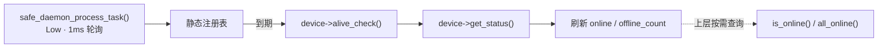

# safe_daemon_process 安全守护进程（电机离线检测）

> 位置：`User/APP/safe_daemon_process/`（`safe_daemon_process.h` / `.cpp`）
> 定位：**只做离线检测与状态上报**，不做任何安全动作（不清零目标、不禁止发射、不锁存）
> 关联规范：`User/Docs/RoboMaster电控C++开发规范.md`（§1.3 注册表解耦、§6.1 任务划分、§7.3 掉线保护）
> 版本：v0.1　日期：2026-09-18

---

## 1. 职责

一个任务 + 一个调用点：到期调用各电机的 `alive_check()`（驱动内部做"滑动窗口 flag 比较"并更新自身状态），
再读 `get_status()` 刷新本层的在线状态与统计，仅此而已。



| 项 | 做法 |
|---|---|
| 一个任务 | `safe_daemon_process_task()`，`osPriorityLow`，轮询 1ms |
| 一个调用点 | 全工程唯一调用 `alive_check()` 的位置在本模块任务内 |
| 解耦 | 本层不写任何控制量；上层用 `is_online()` 自行决定（是否进安全态） |
| 无动态内存 | 静态注册表 `safe_daemon_process_table[SAFE_DAEMON_PROCESS_MAX]` |
| 无 HAL | 只用 `osDelay()` / `osKernelGetTickCount()` 与驱动公有接口 |

## 2. 文件与任务创建

| 文件 | 说明 |
|---|---|
| `safe_daemon_process.h` | 配置宏、两个回调类型、注册表结构、接口、C++ 注册宏（**驱动 include 已用 `#ifdef __cplusplus` 包起，故本头对 C 侧可 include**） |
| `safe_daemon_process.cpp` | 注册表实现与守护任务 |

任务由 **CubeMX(`.ioc`)** 管理（`FREERTOS.Tasks01`）：

```
;safe_daemon_process,8,256,safe_daemon_process_task,As weak,NULL,Dynamic,NULL,NULL
```

字段：名称, 优先级(8=`osPriorityLow`), 栈(字, 256→生成 `256*4`=1KB), 入口函数, As weak, -, Dynamic, -, -。

> ⚠️ CubeMX 重新生成之前任务不存在 → 注册表有内容但 `check_count` 恒为 0（**编译仍通过，不会报错**）。
> 排查"掉线没反应"时先看这一点。

## 3. 接口

| 接口 | 说明 |
|---|---|
| `safe_daemon_process_register(name, device, check, status, period_ms)` | 注册；init 阶段调用；**返回 1=成功 / 0=失败**（参数为空、同指针重复注册、超出 `SAFE_DAEMON_PROCESS_MAX`） |
| `SAFE_DAEMON_PROCESS_REGISTER(name, obj, period_ms)`（宏） | 自动生成 `alive_check()` 适配器与 `get_status()` 在线判据，**业务侧无需写适配函数**；返回值可直接忽略 |
| `safe_daemon_process_task(void *)` | 守护任务（唯一检测调用点） |
| `safe_daemon_process_is_online(const void *device)` | 单设备查询；**未注册返回 0**（防止漏注册被误认为在线） |
| `safe_daemon_process_all_online(void)` | 全部在线返回 1 |
| `safe_daemon_process_get_table(uint8_t *count)` | 取**只读**注册表指针（观察/自行遍历；状态与统计由守护任务维护） |

两个回调必须来自**同一设备对象**：它们读的是同一份 `motor_status`（`alive_check()` 写、`get_status()` 读），传错会出现"检测对象与判据不一致"。

### 在线判据的自动匹配

`get_status()` 的返回类型决定"在线"枚举值，映射写在头文件的特化里（新增驱动类型时补一条）：

```cpp
safe_daemon_process_online_value<dm_motor_status>    → Motor_DM_Status_Enable
safe_daemon_process_online_value<dji_motor_status_e> → Motor_DJI_Status_Enable
safe_daemon_process_online_value<lk_motor_status>    → Motor_LK_Status_Enable
```

## 4. 配置宏与依据

| 宏 | 值 | 依据 |
|---|---:|---|
| `SAFE_DAEMON_PROCESS_MAX` | 8 | 当前占用 6（云台 3 + 发射 3），余量 2；新增设备需同步调大 |
| `SAFE_DAEMON_PROCESS_POLL_PERIOD_MS` | 1 | 任务轮询周期，即检测周期的时间分辨率 |
| `SAFE_DAEMON_PROCESS_PERIOD_MOTOR_MS` | 5 | DJI（C620/C610/GM6020）`alive_check()` 无副作用，反馈约 1kHz |
| `SAFE_DAEMON_PROCESS_PERIOD_MOTOR_RETRY_MS` | 20 | DM/LK 的 `alive_check()` 掉线时会 `can_send_enter()` 重发使能，5ms 会变 200 帧/s 刷 CAN |
| `SAFE_DAEMON_PROCESS_STARTUP_DELAY_MS` | 1000 | 上电静默期，避免首轮把尚未反馈的电机误判为掉线 |

**检测时延** ≈ 该设备的 `period_ms`（DM/LK 20ms，DJI 5ms）＋ 守护任务被抢占的 1~2ms。

### 两个已知边界

- **空指针保护（驱动侧）**：DM/LK 的 `alive_check()` 在掉线时会调 `can_send_enter()`（解引用 `can_rx_frame->hcan`），
  因此这两个类的 `alive_check()` 开头有 `if (can_rx_frame == nullptr) return;`——上电/复位后若 CAN 中断先于 `init()`，
  或 `init()` 因句柄为空提前返回，也不会误用未绑定的总线。DJI 三个类不碰该指针，无需保护。
- **总线负载（DM/LK 数量增长）**：DM/LK 掉线期间每 `period_ms` 发一帧使能（20ms → 50 帧/s，可忽略）；
  若将来 DM/LK 设备数量明显增多，需重新评估 CAN 负载（见规范 §6.5）。

## 5. 当前注册表（6 个电机）

| 设备 | 类型 | 周期(ms) | 注册位置 |
|---|---|---:|---|
| `gimbal.pitch_motor` | DM 3519 | 20 | `gimbal_init()` 第 11 步 |
| `gimbal.yaw_small_motor` | GM6020 | 5 | 同上 |
| `gimbal.yaw_big_motor` | LK | 20 | 同上 |
| `shoot.fric_r_motor` | C620 | 5 | `shoot_init()` 末尾 |
| `shoot.fric_l_motor` | C620 | 5 | 同上 |
| `shoot.trigger_motor` | C610 | 5 | 同上 |

## 6. 添加新设备

```cpp
#include "safe_daemon_process.h"

// 一行完成: 自动取 alive_check() 与 get_status() 的在线判据
SAFE_DAEMON_PROCESS_REGISTER("my_motor", my_module.motor, SAFE_DAEMON_PROCESS_PERIOD_MOTOR_MS);
```

若新驱动类型的 `get_status()` 返回类型是新的枚举，需在头文件补一条
`safe_daemon_process_online_value<新枚举>` 特化。

## 7. 上层如何用（不进本模块）

```cpp
// 轮询方式（推荐, 零耦合）: 在需要保护的地方自行判断
if (safe_daemon_process_is_online(&gimbal.pitch_motor) == 0)
{
    // 自行决定动作: 进安全态 / 限幅 / 上报
}
```

🔴 若要接入安全动作，必须遵守规范 §7.3：**掉线锁存**（恢复在线不自动恢复控制，需操作手按回安全档解锁）、
安全态**只能清目标不能跳过下发**（DJI 失联后会保持最后一次控制量）。这部分**当前未实现**，列在规范 §12.D TODO。

## 8. Ozone 观察

| 字段 | 含义 |
|---|---|
| `check_count` | 累计检测次数（**为 0 说明任务没跑**） |
| `online` | 1=在线，0=离线 |
| `offline_count` | 累计掉线次数（短而多 = 接触不良；单次长 = 真断线） |
| `period_ms` / `last_check_tick` | 检测周期与上次检测时刻（ms） |

## 9. 常见错误与排查

| 现象 | 可能原因 | 排查 |
|---|---|---|
| `check_count` 恒为 0 | 守护任务未创建（CubeMX 未生成 `.ioc` 里那条线程） | 看生成后的 `freertos.c` 是否有 `safe_daemon_process_task` |
| 一上电就报离线 | 电机未上电/未插线（属预期） | 电机上电后 `online` 应自动回到 1 |
| 某电机永远在线 | 未注册（`is_online()` 对未注册返回 0，但表里没有该项） | 检查该模块 `init()` 是否调用了注册宏 |
| 掉线误报频繁 | 检测周期过短（DM/LK 用了 5ms） | 改用 `SAFE_DAEMON_PROCESS_PERIOD_MOTOR_RETRY_MS` |
| 编译报 `safe_daemon_process_online_value<...>` 不完整 | 该驱动状态枚举未加特化 | 在头文件补特化 |
