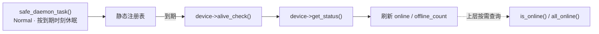

# safe_daemon_process 安全守护进程（电机离线检测）

> 位置：`User/APP/safe_daemon_process/`（`safe_daemon_process.h` / `.cpp`）
> 定位：**只做离线检测与状态上报**，不做任何安全动作（不清零目标、不禁止发射、不锁存）
> 关联规范：`User/Docs/RoboMaster电控C++开发规范.md`（§1.3 注册表解耦、§6.1 任务划分、§7.3 掉线保护）
> 版本：v0.4　日期：2026-11-11　（v0.4：新增 `is_ready()` / `get_device_status()`，上层可做去抖与锁存；v0.3：接入 PC 视觉与 HI12 IMU、新增 `REGISTER_AS`、容量 16→20）

---

## 1. 职责

一个任务 + 一个调用点：到期调用各电机的 `alive_check()`（驱动内部做"滑动窗口 flag 比较"并更新自身状态），
再读 `get_status()` 刷新本层的在线状态与统计，仅此而已。



| 项         | 做法                                                                                                     |
| ---------- | -------------------------------------------------------------------------------------------------------- |
| 一个任务   | `safe_daemon_task()`，`osPriorityNormal`（`.ioc` 优先级 24），按最近一台设备的到期时刻 `osDelay` |
| 一个调用点 | 全工程唯一调用 `alive_check()` 的位置在本模块任务内                                                    |
| 解耦       | 本层不写任何控制量；上层用 `is_online()` 自行决定（是否进安全态）                                      |
| 无动态内存 | 静态注册表 `safe_daemon_process_table[SAFE_DAEMON_PROCESS_MAX]`（20 项） |
| 无 HAL     | 只用 `osDelay()` / `osKernelGetTickCount()` 与驱动公有接口                                           |

## 2. 文件与任务创建

| 文件                        | 说明                                                                                                                                   |
| --------------------------- | -------------------------------------------------------------------------------------------------------------------------------------- |
| `safe_daemon_process.h`   | 配置宏、两个回调类型、注册表结构、接口、C++ 注册宏（**驱动 include 已用 `#ifdef __cplusplus` 包起，故本头对 C 侧可 include**） |
| `safe_daemon_process.cpp` | 注册表实现与守护任务                                                                                                                   |

任务由 **CubeMX(`.ioc`)** 管理（`FREERTOS.Tasks01`），当前条目：

```
;safe_daemon,24,256,safe_daemon_task,As weak,NULL,Static,safe_daemonBuffer,safe_daemonControlBlock
```

字段：名称, 优先级(24=`osPriorityNormal`, 8=`osPriorityLow`), 栈(字, 256→生成 `256*4`=1KB), 入口函数, As weak,
`-`, `Static`(静态分配), 栈缓冲变量名, 控制块变量名。

> 入口函数名由 CubeMX 的线程名 `safe_daemon` 决定，**必须与 `.cpp` 里的强定义 `safe_daemon_task()` 一致**，
> 否则弱桩会空转（编译不报错，`check_count` 恒为 0）。

> ⚠️ CubeMX 重新生成之前任务不存在 → 注册表有内容但 `check_count` 恒为 0（**编译仍通过，不会报错**）。
> 排查"掉线没反应"时先看这一点。

## 3. 接口

| 接口                                                                     | 说明                                                                                                                           |
| ------------------------------------------------------------------------ | ------------------------------------------------------------------------------------------------------------------------------ |
| `safe_daemon_process_register(name, device, check, status, period_ms)` | 注册；在各模块 `init()` 里调用；**返回 1=成功 / 0=失败**（参数为空、同指针重复注册、超出 `SAFE_DAEMON_PROCESS_MAX`） |
| `SAFE_DAEMON_PROCESS_REGISTER(name, obj, period_ms)`（宏）             | 自动生成 `alive_check()` 适配器与 `get_status()` 在线判据（判据取自本头的状态枚举特化），**业务侧无需写适配函数**；返回值可直接忽略 |
| `SAFE_DAEMON_PROCESS_REGISTER_AS(name, obj, online_value, period_ms)`（宏） | 同上，但**在线判据由调用点显式给出**；用于不便往本头补特化的设备（IMU / PC 视觉），并支持 `volatile` 全局对象 |
| `safe_daemon_task(void *)`                                             | 守护任务（唯一检测调用点）                                                                                                     |
| `safe_daemon_process_is_online(const void *device)`                    | 单设备查询；**未注册返回 0**（防止漏注册被误认为在线）                                                                   |
| `safe_daemon_process_all_online(void)`                                 | 全部在线返回 1；**空表返回 0**（未注册任何设备不能当作"全部在线"）                                                       |
| `safe_daemon_process_is_ready(void)` | 所有已注册设备都至少检测过一次才返回 1；用于区分"真在线"与"静默期内还没测过" |
| `safe_daemon_process_get_device_status(device, &st)` | 单设备状态快照：`online` / `evaluated`（是否已评估）/ `offline_ms`（连续离线时长）/ `offline_count`；未注册时返回 0 并给全零快照 |
| `safe_daemon_process_get_table(uint8_t *count)`                        | 取**只读**注册表指针（观察/自行遍历；状态与统计由守护任务维护）                                                          |
| `safe_daemon_process_get_reject_count(void)`                           | 累计注册失败次数，`0` 表示全部注册成功；失败项的设备名见静态变量 `safe_daemon_process_last_reject_name`                    |

两个回调必须来自**同一设备对象**：它们读的是同一份状态字段（`alive_check()` 写、`get_status()` 读），传错会出现"检测对象与判据不一致"。

### 两个注册宏怎么选

```cpp
// 电机: 判据已在本头文件特化, 直接用 REGISTER
SAFE_DAEMON_PROCESS_REGISTER("fric_r_motor", shoot.fric_r_motor, SAFE_DAEMON_PROCESS_PERIOD_MOTOR_MS);

// 非电机(IMU / PC 视觉): 判据就地给出, 本头不需要 include 该驱动头
SAFE_DAEMON_PROCESS_REGISTER_AS("hi12_imu", hi12_data,
                                HI12_Connection_Status_Enable, SAFE_DAEMON_PROCESS_PERIOD_SENSOR_MS);
```

`REGISTER_AS` 里的 `const_cast<void *>(static_cast<const volatile void *>(&(obj)))` 是为了兼容 `volatile`
全局对象（`hi12_data` 是 `volatile hi12_gyro`）：`volatile T *` 不能直接转 `void *`，先补成
`const volatile void *` 再由 `const_cast` 去掉；非 volatile 对象用同一宏也完全正常。

### 注册是跨任务并发的

`gimbal` / `chassis` / `shoot` 三个任务各自在自己的 `init()` 里注册，**不是单写者**。因此
`safe_daemon_process_register()` 内部用 `taskENTER_CRITICAL()` 把「查重 → 占位 → 发布 `count`」放在同一临界区，
避免两个任务读到同一个下标互相覆盖；失败只累加统计，**不会写坏已发布的表项**。

### 在线判据的自动匹配

`get_status()` 的返回类型决定"在线"枚举值，映射写在头文件的特化里（新增驱动类型时补一条）：

```cpp
safe_daemon_process_online_value<dm_motor_status>    → Motor_DM_Status_Enable
safe_daemon_process_online_value<dji_motor_status_e> → Motor_DJI_Status_Enable
safe_daemon_process_online_value<lk_motor_status>    → Motor_LK_Status_Enable
```

**非电机设备不需要改这里**：用 `SAFE_DAEMON_PROCESS_REGISTER_AS` 在调用点传判据即可，
避免本头文件被动引入 HAL / USB 等依赖。

## 4. 配置宏与依据

| 宏                                            |   值 | 依据                                                                                                                                                                          |
| --------------------------------------------- | ---: | ----------------------------------------------------------------------------------------------------------------------------------------------------------------------------- |
| `SAFE_DAEMON_PROCESS_MAX`                   |   20 | 当前占用 17（云台 4 + 底盘 8 + 发射 3 + PC 视觉 1 + HI12 IMU 1），余量 3；新增设备需同步调大                                                                                  |
| `SAFE_DAEMON_PROCESS_POLL_PERIOD_MS`        |    1 | **最小休眠粒度**：任务按"最近一台设备的到期时刻"休眠，该值只在注册表为空时兜底                                                                                          |
| `SAFE_DAEMON_PROCESS_PERIOD_MOTOR_MS`       |  100 | 反馈周期约 1ms，连续 100ms 无新帧即判定掉线；DJI（C620/C610/GM6020）的 `alive_check()` 无总线副作用，**当前所有电机调用点都用它**                                         |
| `SAFE_DAEMON_PROCESS_PERIOD_SENSOR_MS`      |  100 | 非电机设备（IMU / PC 视觉）的检测周期，与电机同窗口；单独命名避免"电机周期"用在传感器上 |
| `SAFE_DAEMON_PROCESS_PERIOD_MOTOR_RETRY_MS` |   20 | 掉线时会 `can_send_enter()` 重发使能的 DM/LK **需要更快检测/恢复时**使用；代价是掉线期间每 `period_ms` 发一帧使能（20ms → 50 帧/s/台），**当前调用点未使用** |
| `SAFE_DAEMON_PROCESS_STARTUP_DELAY_MS`      | 1000 | 上电静默期，避免首轮把尚未反馈的电机误判为掉线                                                                                                                                |

**检测时延** ≈ 该设备的 `period_ms`（当前统一 100ms）＋ 守护任务被抢占的 1~2ms。想缩短 DM/LK 的掉线发现时间，
就把该设备的注册周期换成 `SAFE_DAEMON_PROCESS_PERIOD_MOTOR_RETRY_MS`（20ms），并评估 CAN 负载。

### 为什么不是固定 1ms 轮询

任务按"最近一台设备的到期时刻"休眠，同相位的设备会在同一拍被唤醒：

| 场景                             |    固定 1ms 轮询 | 按到期时刻休眠 |
| -------------------------------- | ---------------: | -------------: |
| 当前配置（17 台，100ms，同相位） | ≈ 1000 次唤醒/s | ≈ 10 次唤醒/s |
| 混合周期 10/20/50/100ms（仿真）  | ≈ 1000 次唤醒/s |   100 次唤醒/s |

检测精度不变（到期才检测），但把常态下的调度唤醒减少了两个数量级——该任务优先级是 `Normal`，
与控制任务同级，空转唤醒越少，对 1kHz 控制链路的扰动越小。

> 代价：休眠时长 = "最近一台设备还剩多少时间"。若某设备周期特别长（如秒级），
> 运行中才注册的设备最晚要等一个长周期才会被纳入检测。当前 17 台统一 100ms，不存在该问题。

### 两个已知边界

- **空指针保护（驱动侧）**：DM/LK 的 `alive_check()` 在掉线时会调 `can_send_enter()`（解引用 `can_rx_frame->hcan`），
  因此这两个类的 `alive_check()` 开头有 `if (can_rx_frame == nullptr) return;`——上电/复位后若 CAN 中断先于 `init()`，
  或 `init()` 因句柄为空提前返回，也不会误用未绑定的总线。DJI 三个类不碰该指针，无需保护。
- **总线负载（DM/LK 数量增长）**：DM/LK 掉线期间每 `period_ms` 发一帧使能（100ms → 10 帧/s/台，可忽略；
  换成 20ms 则 50 帧/s/台）；若将来 DM/LK 设备数量明显增多，需重新评估 CAN 负载（见规范 §6.5）。

## 5. 当前注册表（17 个设备）

| 设备                               | 驱动类型                         | 周期(ms) | 注册位置                                   |
| ---------------------------------- | -------------------------------- | -------: | ------------------------------------------ |
| `gimbal.small_yaw_motor`         | DM（`dm_motor_normal_class`）  |      100 | `gimbal_init()`（gimbal.cpp:309~312）    |
| `gimbal.small_pitch_motor`       | DM                               |      100 | 同上                                       |
| `gimbal.big_pitch_motor`         | DM                               |      100 | 同上                                       |
| `gimbal.big_yaw_motor`           | DM                               |      100 | 同上                                       |
| `chassis.wheel_motor[0]`~`[3]` | C620（`dji_c620_motor_class`） |      100 | `chassis_init()`（chassis.cpp:178~186）  |
| `chassis.steer_motor[0]`~`[3]` | DM（`dm_motor_normal_class`）  |      100 | 同上                                       |
| `shoot.fric_r_motor`             | C620                             |      100 | `shoot_init()` 末尾（shoot.cpp:104~106） |
| `shoot.fric_l_motor`             | C620                             |      100 | 同上                                       |
| `shoot.trigger_motor`            | C610（`dji_c610_motor_class`） |      100 | 同上                                       |
| `pc_vision`                      | `pc_to_mcu_vision_class`       |      100 | `robot_decision_init()`（robot_decision.cpp） |
| `hi12_imu`                       | `hi12_gyro`（volatile 全局对象） |      100 | 同上                                       |

合计 17 项，`SAFE_DAEMON_PROCESS_MAX` = 20，余量 3——**加设备前先确认空位**，
否则注册会失败（`safe_daemon_process_reject_count` 增加，Ozone 可见）。

### 上电 1s 内的语义

注册时 `online = 1`，守护任务在静默期结束后再统一置 1，**第一次检测发生在"静默期结束 + 该设备 period_ms"**。
因此上电后约 1.1s 内 `is_online()` 对所有设备都返回 1，即使电机没上电——这是刻意的，避免上电误报。

要区分"真在线"与"还没测过"，不要自己去读 `check_count`，直接用：

```cpp
if (safe_daemon_process_is_ready())
{
    // 此时所有设备的 online 都是实测值, 可以开始做掉线锁存
}

// 或者按设备判断
safe_daemon_process_device_status_t st;
if (safe_daemon_process_get_device_status(&hi12_data, &st) && st.evaluated == 0)
{
    // 该设备还没被检测过, 先不下结论
}
```

### 去抖与锁存（`offline_ms` 的用法）

单次 100ms 窗口漏帧就可能被判离线，直接动作容易误触发。`get_device_status()` 把"已连续离线多久"
算好给你，上层不必自己记时间戳：

```cpp
safe_daemon_process_device_status_t st;

if (safe_daemon_process_get_device_status(&gimbal.small_yaw_motor, &st) && st.evaluated)
{
    if (st.online == 0 && st.offline_ms >= 300)   // 连续掉线 300ms 才认定真掉线
    {
        // 进入安全态并锁存
    }
}
```

`offline_ms` 由"当前 tick − 掉线起始 tick"的无符号差值算出，**天然抗 tick 回绕**，上层无需处理。
它只表示"本次已连续离线多久"，不是"累计离线时长"；累计次数看 `offline_count`。

### 尚未纳入监控的设备（已知缺口）

以下对象同样有 `alive_check()` 与 `get_status()`，但**没有注册**：

| 对象                       | 接口                                                                            | 接入方式                                                                         |
| -------------------------- | ------------------------------------------------------------------------------- | -------------------------------------------------------------------------------- |
| `abs_encoder_class`      | `alive_check()` + `abs_encoder_status_e get_status()`                       | `SAFE_DAEMON_PROCESS_REGISTER_AS("yaw_encoder", yaw_encoder, Abs_Encoder_Status_Enable, SAFE_DAEMON_PROCESS_PERIOD_SENSOR_MS)` |
| `crsf_class`             | `crsf_alive_check()` + `get_connection_status()`                            | 成员函数名与判据都不同，需手写两个回调后调 `safe_daemon_process_register()`    |

接入它们会**改变现有的掉线判定范围**（新增设备一旦离线会拉低 `all_online()`），因此当前未默认开启。

### PC 视觉与 HI12 IMU 的接入要点

| 项 | 说明 |
|---|---|
| 判据 | `PC_Connection_Status_Enable` / `HI12_Connection_Status_Enable`，由 `REGISTER_AS` 在调用点给出 |
| 驱动前提 | `pc_to_mcu_vision_class::data_unpack()` 每收一帧有效数据 `flag += 1`（**v0.3 补上，此前缺失**） |
| 掉线副作用 | PC 的 `alive_check()` 会把 `rx_data.control_mode` 清 0 ⇒ `get_control_mode()` 返回 0，`shoot_update_mode()` 的自动模式自动落到 `Shoot_Ceasefire`；HI12 的 `alive_check()` 只更新状态，无副作用 |
| 数据率要求 | 窗口是"连续 `period_ms` 无新帧即离线"。PC 视觉建议 ≥ 20Hz、HI12 ≥ 100Hz；若 PC 视觉频率低于 10Hz，需把该设备周期调大（如 200ms）避免抖动 |
| 上电 | PC 未插线时 1s 静默期后约 100ms 内即报离线，属预期；**不要**把 `all_online()` 当作"允许发射"的总闸（见 §7） |

## 6. 添加新设备

```cpp
#include "safe_daemon_process.h"

// 电机: 判据已有特化, 一行完成
SAFE_DAEMON_PROCESS_REGISTER("my_motor", my_module.motor, SAFE_DAEMON_PROCESS_PERIOD_MOTOR_MS);

// 非电机(IMU / 编码器 / 视觉等): 判据就地给出, 不必改本头文件
SAFE_DAEMON_PROCESS_REGISTER_AS("my_sensor", my_module.sensor,
                                My_Sensor_Status_Enable, SAFE_DAEMON_PROCESS_PERIOD_SENSOR_MS);
```

只有"希望用 `REGISTER`（不给判据）"时，才需要在头文件补一条
`safe_daemon_process_online_value<新枚举>` 特化。

## 7. 上层如何用（不进本模块）

```cpp
// 轮询方式（推荐, 零耦合）: 在需要保护的地方自行判断
if (safe_daemon_process_is_online(&gimbal.pitch_motor) == 0)
{
    // 自行决定动作: 进安全态 / 限幅 / 上报
}
```

🔴 若要接入安全动作，必须遵守规范 §7.3：**掉线锁存**（恢复在线不自动恢复控制，需操作手按回安全档解锁）、
安全态**只能清目标不能跳过下发**（DJI 失联后会保持最后一次控制量）。这部分**当前未实现**，列在规范 §12.D TODO。

### 不要用 `all_online()` 当总闸

注册表现在包含 PC 视觉与 IMU，两者掉线的正确反应**完全不同**：

| 掉线对象 | 应做的动作 | 不该做的动作 |
|---|---|---|
| IMU（`hi12_imu`） | 禁云台闭环、进安全态 | — |
| PC 视觉（`pc_vision`） | 只禁自瞄；手动/遥控模式照常 | **不能**因为 PC 没插线就整机禁止发射 |
| 单台电机 | 该关节限幅/清目标 | — |

所以只在"确实要求所有设备都在"的场合才用 `all_online()`，其余一律查具体设备：

```cpp
if (safe_daemon_process_is_online(&hi12_data) == 0)
{
    // IMU 掉线: 云台进安全态
}

if (safe_daemon_process_is_online(&robot_decision.pc_to_mcu_aim) == 0)
{
    // PC 掉线: 只关自瞄, 保留手动
}
```

## 8. Ozone 观察

| 字段                                     | 含义                                               |
| ---------------------------------------- | -------------------------------------------------- |
| `check_count`                          | 累计检测次数（**为 0 说明任务没跑，或设备还没被评估过**）        |
| `online`                               | 1=在线，0=离线                                     |
| `offline_count`                        | 累计掉线次数（短而多 = 接触不良；单次长 = 真断线） |
| `offline_since_tick` | 本次掉线的起始时刻（ms）；`get_device_status()` 用它算 `offline_ms` |
| `period_ms` / `last_check_tick`      | 检测周期与上次检测时刻（ms）                       |
| `safe_daemon_process_count`            | 已注册设备数（**小于 17 说明有注册失败**）   |
| `safe_daemon_process_reject_count`     | 累计注册失败次数                                   |
| `safe_daemon_process_last_reject_name` | 最近一次注册失败的设备名（字符串指针）             |

> 注册表条目增加 `offline_since_tick` 后每条 40 字节，20 条共 800 字节（DTCM）。

## 9. 常见错误与排查

| 现象                                                    | 可能原因                                                             | 排查                                                                       |
| ------------------------------------------------------- | -------------------------------------------------------------------- | -------------------------------------------------------------------------- |
| `check_count` 恒为 0                                  | 守护任务未创建（CubeMX 未生成 `.ioc` 里那条线程）                  | 看生成后的 `freertos.c` 是否有 `safe_daemon_task`                      |
| 一上电就报离线                                          | 电机未上电/未插线（属预期）                                          | 电机上电后 `online` 应自动回到 1                                         |
| 某电机永远在线                                          | 未注册（`is_online()` 对未注册返回 0，但表里没有该项）             | 检查该模块 `init()` 是否调用了注册宏                                     |
| 某电机未进注册表                                        | 注册失败：超出 `SAFE_DAEMON_PROCESS_MAX`、同指针重复注册、回调为空 | 看 `safe_daemon_process_count` / `reject_count` / `last_reject_name` |
| 掉线误报频繁                                            | 检测周期过短（DM/LK 用了 `PERIOD_MOTOR_RETRY_MS` 而反馈本来就慢）  | 改用 `SAFE_DAEMON_PROCESS_PERIOD_MOTOR_MS`                               |
| PC 视觉一直报离线                                        | `data_unpack()` 未自增 `flag`（**v0.3 前的老问题**）；或 PC 数据率低于 10Hz | 看 `pc_to_mcu_aim` 的 `flag` 是否增长；必要时把周期调大到 200ms |
| IMU 一直报离线                                          | `hi12_alive_check()` 没被调用过（**v0.3 前的老问题**）；串口未初始化 | 确认 `robot_decision_init()` 里的 `REGISTER_AS` 存在；查 UART10 接线 |
| 编译报 `safe_daemon_process_online_value<...>` 不完整 | 该驱动状态枚举未加特化                                               | 改用 `SAFE_DAEMON_PROCESS_REGISTER_AS` 就地给判据，或补特化               |
