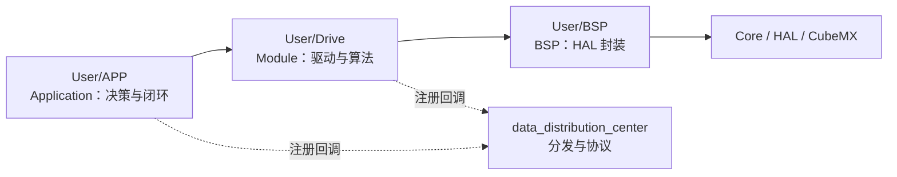

# RoboMaster 电控 C++ 开发规范（v0.1）

> 项目：`robot_mc02_2026`（步兵 / infantry，STM32H723 + FreeRTOS + CMake）
> 本文件位置：`User/Docs/RoboMaster电控C++开发规范.md`（对应流程文档中提到的 `RoboMaster电控C_Cpp开发规范_v0.1.md`）
> 配套流程文档：`User/Docs/在Agent情况下如何进行电控开发.md`
> 维护：HNAU-Robot 电控组　版本：v0.1　日期：2026-09-18

**标记约定**：🔴 强制项（Review 必须检查）；🟢 推荐项（不做不阻塞，但要在 PR 里说明理由）。

**制定依据**：本规范不是凭空制定的，全部规则都从本仓库既有代码归纳收敛而来，示例取自真实文件。当规范与历史代码冲突时：
1. 新写的代码按规范执行；
2. 修改老代码时只对齐本次改动涉及的部分，**不做无关的全文件重排**（避免巨大 diff 无法审查）。

---

## 0. 本规范的定位与使用方式

### 0.1 三类文档体系（流程文档要求的落地形式）

流程文档要求仓库必须准备两类文档（代码开发规范 + 技术交付文档），并允许补充模块说明文档。本仓库的落地约定如下：

| 文档类型 | 作用 | 本仓库路径 | 状态 |
|---|---|---|---|
| **代码开发规范**（本文件） | Agent 与人的统一编码规则 | `User/Docs/RoboMaster电控C++开发规范.md` | ✅ 已有 |
| **Agent 协作流程** | 任务描述、开发流程、边界 | `User/Docs/在Agent情况下如何进行电控开发.md` | ✅ 已有 |
| **模块说明文档** | 单个驱动的协议、接口、用法 | `<模块目录>/<模块名>.md`（如 `lk_motor/lk_motor.md`、`sweep_frequency/sweep_frequency.md`） | 🟢 已有的照做，新模块建议补 |
| **技术交付文档** | 整车 / 核心控制方案的工程说明书 | `User/Docs/<车或方案>-技术交付文档.md` | 🔴 待补（`步兵2026-技术交付文档.md`） |
| **仓库 README** | 项目入口、Agent 使用说明 | 仓库根 `README.md` | 🔴 待补 |

### 0.2 阅读顺序

**人**：本文件 → 流程文档 → 当前模块说明 / 技术交付文档。

**Agent**：每次开发前必须先读（顺序固定）：

```
1. User/Docs/RoboMaster电控C++开发规范.md              ← 本文件（编码规则）
2. User/Docs/在Agent情况下如何进行电控开发.md            ← 协作流程与边界
3. User/Docs/<当前车/方案>-技术交付文档.md               ← 若不存在，要求人补充或先确认
4. 与任务相关的模块说明 .md + 相关头文件（robot_def.h 必读）
```

🔴 **未读规范不得开始写代码**；Agent 必须先给修改计划，经人确认后再动代码。

### 0.3 术语对齐

本规范使用流程文档的通用术语，与本仓库目录的对应关系：

| 流程文档术语 | 本仓库实现 | 说明 |
|---|---|---|
| Application | `User/APP/` | 业务决策与闭环组织（gimbal / shoot / chassis / steering_wheel / robot_decision） |
| Module | `User/Drive/` | 设备驱动与算法（brush_motor / imu / encoder / remote_control / odometer / algorithm） |
| BSP | `User/BSP/` | HAL 封装（bsp_can / bsp_uart / bsp_dwt / bsp_log …） |
| HAL / CubeMX | `Core/`、`Drivers/`、`Middlewares/` | 生成代码与第三方 |

---

## 1. 分层与依赖（禁止绕过分层）

### 1.1 目录职责

| 目录 | 职责 | 备注 |
|---|---|---|
| `Core/` | CubeMX 生成：`main.c`、`freertos.c`、外设初始化、中断向量 | 只在 `USER CODE BEGIN/END` 区内修改 |
| `User/BSP/` | 板级支持：只封装 HAL，不含业务语义 | 对外接口一律 `bsp_<外设>_<动作>` |
| `User/Drive/algorithm/` | 纯算法（pid / filter / feedforward / slope / basic_math / wave_generator …） | 🔴 不依赖 BSP，不 include 业务头 |
| `User/Drive/`（其余） | 设备驱动：电机、IMU、编码器、遥控器、里程计 | 只通过 BSP 访问硬件 |
| `User/Drive/data_distribution_center/` | 跨模块装配：`can_distribution`（CAN 接收分发）、`pc_communication`、`can_board_communication` | 不含具体业务逻辑 |
| `User/APP/` | 业务应用，物理参数集中在 `robot_def.h` | 🔴 不直接调用 HAL |
| `User/test/` | 调试与实验任务 | 可整体裁剪 |
| `User/Docs/` | 规范与交付文档 | 与代码同仓库演进 |
| `USB_DEVICE/`、`Middlewares/`、`Drivers/`、`cmake/` | 生成代码与第三方 | 原则上不修改 |

### 1.2 依赖方向

🔴 **Application 调 Module，Module 调 BSP，BSP 调 HAL**，不允许跳层与反向：



禁止写法（🔴 Review 直接打回）：

```cpp
// ❌ Application 里直接写 HAL
HAL_CAN_AddTxMessage(&hfdcan1, &header, data, &mailbox);
HAL_UART_Transmit(&huart1, buf, len, 100);
```

正确写法：

```cpp
bsp_fdcan_send(&hfdcan1, can_tx_id, tx_data, 8);              // Module → BSP
bsp_can_1_to_4_transmit(&hfdcan1, 0x1fe, can1_0x1fe_tx_data, Can_transmit_frequency_1000Hz);
```

（当前仓库 `User/APP` 下 `HAL_*` 调用为 **0 处**，保持这个状态。）

### 1.3 跨模块解耦

🟢 跨模块协作**优先走注册表 / 函数指针**，不要互相 include 具体业务头文件。已有范例 `can_distribution`：

```cpp
typedef void (*can_rx_client_t)(const volatile FDCAN_RxFrame_TypeDef *frame);
void can_distribution_register(uint8_t hcan_id, uint32_t can_rx_id, can_rx_client_t rx_client);
```

- 🔴 业务模块**不得自行强定义** `fdcanX_rx_callback()`（会与 `can_distribution.cpp` 多重定义冲突），一律在 `init()` 里注册。
- 🟢 存活检测同理：推荐"**一个任务 + 一个函数**"统一调用各设备 `alive_check()`（静态注册表 + 类型擦除回调），避免在各业务任务里散落调用；注册表用宏固定容量（如 `XXX_MAX`），禁止动态内存。

### 1.4 构建登记（🔴 新增文件必须做）

`CMakeLists.txt` 两处都要加，漏一处即"链接 undefined"或"找不到头文件"：

```cmake
target_sources(${CMAKE_PROJECT_NAME} PRIVATE
    User/Drive/data_distribution_center/can_distribution/can_distribution.cpp
)

target_include_directories(${CMAKE_PROJECT_NAME} PRIVATE
    User/Drive/data_distribution_center/can_distribution      # 写目录，不写文件名
)
```

🟢 暂不启用的模块用注释保留（仓库现状）：

```cmake
# User/APP/chassis/chassis.cpp
# User/APP/steering_wheel/steering_wheel.cpp
```

### 1.5 禁止清单（Agent 与人共同遵守，对应流程文档 §5.1）

以下改动**必须先征求人确认**，不得擅自实施：

```
1. BSP 对外函数签名变化
2. Module 公共接口变化（单位、语义、参数含义）
3. 跨模块通信变化：CAN ID、帧格式、注册表接口
4. robot_def.h 中机器人物理参数/限幅宏变化
5. 电机控制模式变化（MIT / Omega / Angle / 1拖4 …）
6. 任务周期、任务优先级、新增/删除任务
7. 安全保护逻辑变化（限幅、Zero-Force、掉线处理、上电默认状态）
8. 大面积格式化或重排（会把真实改动淹没）
9. 删除历史代码、注释掉的旧实现、历史文档
10. 架构级替换（如串级 PID → LQR / ESO），必须先出方案文档
```

🟢 允许 Agent 自主执行：按既有风格补代码、写注释、补模块 `.md`、搜索调用链、整理参数来源表、新增独立模块（并登记 CMake 两处）、不动公共接口的局部重构。

---

## 2. 命名规范

### 2.1 文件与目录

- 全小写 + 下划线：`dm_motor.h`、`can_distribution.cpp`、`wheel_system_solution.cpp`。
- 模块目录名 = 模块名 = 文档名：`lk_motor/lk_motor.h` + `lk_motor.md`。
- 驱动按厂家/型号分目录：`brush_motor/{dji_motor, dji_motor_new, dm_motor, lk_motor}`；新旧并存用 `_new` 后缀。
- 头文件统一 `#pragma once`（🟢 老文件的 `#ifndef __XXX_H` 不强制迁移）。

### 2.2 类型命名

| 类别 | 规则 | 实例 |
|---|---|---|
| 类 | `小写下划线 + _class` | `pid_class`、`dm_motor_1_to_4_class`、`abs_encoder_class`、`crsf_class` |
| 模板类 | `class_` 前缀或 `_class` | `class_filter_frequency<10>` |
| 结构体 | 小写下划线 + `_t` | `gimbal_t`、`wheel_motor_status_t`、`pid_term_t`、`steering_wheel_t` |
| 协议裸报文 | 语义化命名（可省 `_t`） | `lk_motor_source_data`、`dm_motor_rx_data_normal` |
| 枚举类型 | 小写下划线 + `_e` | `gimbal_method_e`、`crsf_link_status_e`、`dji_motor_control_method_e` |
| 函数指针类型 | 小写下划线 + `_t` | `can_rx_client_t` |

### 2.3 枚举成员

规则 `模块或设备_类别_取值`，下划线分段：

```cpp
typedef enum { Motor_DM_Status_Disable = 0, Motor_DM_Status_Enable } dm_motor_status;

typedef enum
{
    Motor_LK_Control_Method_Normal_Torque,   // 扭矩控制
    Motor_LK_Control_Method_Normal_Omega,    // 角速度控制
} lk_motor_control_method;

typedef enum { Can_transmit_frequency_1000Hz = 0, Can_transmit_frequency_500Hz } Can_transmit_frequency_t;

typedef enum { Gimbal_Method_Zero_Force = 0, Gimbal_Method_Manual, Gimbal_Method_Auto } gimbal_method_e;
```

🟢 老算法/协议文件的全大写风格（`PID_D_First_ENABLE`、`CRSF_SWITCH_UP`）保持原样；**同一文件内必须统一**，新文件用上表写法。

### 2.4 变量与类成员

- 全小写 + 下划线；类成员**不加 `m_` 前缀、不加尾下划线**（`k_p`、`out`、`d_t`、`motor_status`）。
- 🔴 成员必须**就地初始化**（`float out = 0.0f;`、`bool first_fb_flag = true;`），不依赖 `init()` 一定被调用。
- 语义前缀（便于全局搜索与 Ozone 观察）：

| 前缀 | 含义 | 实例 |
|---|---|---|
| `now_` | 当前实测（原始） | `now_angle`、`now_omega` |
| `filter_` | 滤波后 | `filter_angle`、`filter_value.fric_r_torque` |
| `target_` / `ref_` | 目标 / 参考 | `target_value.pitch_angle`、`ref_status` |
| `act_` | 执行机构实测 | `act_status.steer_angle` |
| `feedforward_` | 前馈量 | `feedforward_value.small_yaw_torque` |
| `pre_` / `last_` | 上一拍 / 上一次 | `pre_encoder`、`pre_flag`、`last_method` |
| `total_` | 累计量 | `total_round`、`total_angle` |
| `map_` | 遥控映射值 | `map_vx`、`map_vy`、`map_vz` |
| `_flag` | 布尔/标志 | `first_fb_flag`、`allow_flag`、`fric_spin_up_flag` |

- 保护/私有成员用分区注释组织（沿用 `pid.h`、`dji_motor_new.h` 风格）：

```cpp
protected:
    // 初始化相关常量

    // PID计时器周期, s
    float d_t;

    // 常量

    // 内部变量

    // 之前的当前值
    float pre_now = 0.0f;

    // 读变量

    // 写变量
```

### 2.5 函数命名

| 场景 | 规则 | 实例 |
|---|---|---|
| 初始化 | `xxx_init()` | `gimbal_init()`、`shoot_init()` |
| 周期计算回调 | `xxx_calculate_callback()` | `pid_calculate_callback()` |
| 测量/模式更新 | `xxx_update_measure()`、`xxx_update_mode()` | `shoot_update_measure()` |
| 决策 | `xxx_control_decision()` | `gimbal_control_decision()` |
| 中断回调（成员） | `xxx_rx_callback()` | `dm_motor_normal_class::can_rx_callback()` |
| 中断回调（总线级） | `fdcanX_rx_callback()` | 🔴 只允许 `can_distribution.cpp` 强定义 |
| 存活检测 | `xxx_alive_check()` | `crsf_alive_check()`、`alive_check()` |
| 任务函数 | `extern "C" void xxx_task(void *argument)` | `gimbal_task`、`shoot_task` |
| BSP 接口 | `bsp_<外设>_<动作>` | `bsp_fdcan_send()`、`bsp_dwt_get_deltat32()` |
| 通用数学工具 | `basic_math_<动作>` | `basic_math_constrain()`、`basic_math_modulus_normalization()` |
| 具体算法 | 英文语义全称 | `omni_wheel_inverse_kinematics()` |

### 2.6 形参、getter / setter、宏

🔴 初始化形参统一 `const T &__name`（双下划线前缀 + const 引用）+ 默认值：

```cpp
void init(const float &__k_p, const float &__k_i, const float &__k_d, const float &__k_f = 0.0f, const float &__out_max = 0.0f);
```

- getter / setter：`get_xxx()` / `set_xxx()`，`inline` 且在头文件类内实现；getter 加 `const`。
- 🔴 参数集中定义：整机级放 `User/APP/robot_def.h`，模块级放模块头文件顶部宏区。**不允许在 .cpp 里写裸魔法值**。

### 2.7 命名速查

| 对象 | 规则 | 示例 |
|---|---|---|
| 文件/目录 | `lower_snake` | `dm_motor.cpp`、`sweep_frequency/` |
| 类 | `xxx_class` | `pid_class`、`crsf_class` |
| 结构体 | `xxx_t` | `gimbal_t`、`wheel_motor_status_t` |
| 枚举类型 / 成员 | `xxx_e` / `Module_Kind_Value` | `gimbal_method_e`、`Motor_DM_Status_Enable` |
| 宏 | `UPPER_SNAKE` + 单位后缀 | `STEER_WHEEL_DISTANCE_R`、`HEAT_SLOWDOWN_THRESHOLD` |
| 成员变量 | `lower_snake` + 语义前缀 | `now_omega`、`pre_flag` |
| 初始化形参 | `const T &__x` | `const float &__k_p` |
| getter/setter | `get_/set_xxx()`（inline） | `get_now_angle()`、`set_target_omega()` |
| 中断回调 | `xxx_rx_callback()` | `can_rx_callback()` |
| 任务 | `extern "C" xxx_task(void *)` | `gimbal_task` |
| BSP 接口 | `bsp_<外设>_<动作>` | `bsp_can_1_to_4_transmit` |

---

## 3. 注释与文件模板

### 3.1 文件头（🔴 新建文件必备）

```cpp
/**
 * @file can_distribution.cpp
 * @author Robin Liu (19038200162@163.com)
 * @brief 统一的can分发层，提供can总线接收数据的统一分发接口
 * @note  各业务模块注册自己的接收处理函数，中断中查表转发；本层不依赖任何业务模块
 * @date 2026-08-20
 * @version 0.1
 * @copyright HNAU-Robot (c) 2026
 */
```

### 3.2 函数注释（🔴 公共接口必备）

```cpp
/**
 * @brief 电机初始化
 * @param hcan 绑定的CAN总线
 * @param __can_rx_id 收数据绑定的CAN ID, 与上位机Master_ID一致
 * @param __angle_max 最大位置, 与上位机控制幅值PMAX保持一致
 * @note 复位后首帧反馈会重建编码器基准, 防止误计圈
 */
```

### 3.3 注释必须写清的三件事（🔴）

1. **单位**：`// 输出轴角度, rad`、`// 轮子速度设置值, 单位m/s`、`// 母线电压 [0.01V/LSB]`。
2. **坐标系与正方向**：如"机体 X=前 Y=左 Z=上，yaw CCW 为正，角度自 +X 起算"。
3. **量的来源**：手测 / 手册 / 辨识 / 仿真（例：`前馈系数, 从260904采样数据 v7 辨识`）。

### 3.4 参数改动必须留痕（🔴）

任何控制参数、宏阈值改动，必须在定义处或调用处写 **版本 / 日期 / 原因 / 实测结果**：

```cpp
/** @brief 前馈系数, 从260904采样数据 v7 辨识 (修复分析脚本偏差)
 *  ===== v7 修复说明 (2026-09-04) =====
 *  问题: 分析脚本使用 filtfilt 导致 3 个偏差: 隐藏 OLS 缓冲延迟/低通相位滞后/MaxOut 饱和
 *  修复: OLS order 4→2, LPF_RC 0.008→0.003, MaxOut 1.0→4.0
 */

Feedforward_Init(&gimbal.pc_yaw_small_ffc, 0.50f, yaw_small_ff_coeff, 0.003f, 2, 2);
// v5(260917): MaxOut 0.35 → 0.50; 实测贴住 ±0.355 的采样占 7.4%(最快段 23.3%) ⇒ 截断降到约 3%
```

调参提交建议附：`robot / board / motor / symptom / change / result / test`。

### 3.5 数学与坐标系写成块注释

涉及矩阵、坐标变换、解算公式时，按 `wheel_system_solution.cpp` 里程计注释风格写清推导、验证用例、索引定义：

```cpp
/*===========================================================================
 * 麦轮编码器里程计 — 基于累计轮转角的位移解算
 *   Step 1 Δθ_i = wheel_angle_rad[i] - last_angle_rad[i]
 *   Step 4 x(k) = x(k-1) + dx_body·cos(ψ_mid) - dy_body·sin(ψ_mid)
 * 坐标系: 机体 X=前 Y=左 Z=上; 世界 上电位置=(0,0), 上电朝向=+x
 * 轮组布局: FL[0] \  ← 前 →  / FR[3]
 *===========================================================================*/
```

### 3.6 语言与格式

- 注释用中文；行尾注释说明"为什么"，不复述代码。
- 缩进 4 空格，大括号 Allman 风格（与仓库现有代码一致）。
- 🟢 仓库暂无 `.clang-format`；补上后统一格式化，但**格式化必须单独提交**（见 1.5 第 8 条）。

---

## 4. 接口与模块设计

### 4.1 设备类"五件套"（🔴 所有驱动统一）

| 成员 | 作用 |
|---|---|
| `init(...)` | 绑定总线/ID/量程，复位内部状态（含 `first_fb_flag = true`） |
| `get_xxx()` | 只读反馈量（`inline` + `const`） |
| `set_xxx()` | 写目标/控制方式（`inline`） |
| `xxx_calculate_callback()` | 周期计算并下发（由对应任务按帧调用） |
| `alive_check()` | 滑动窗口存活检测（供统一监控调用） |

### 4.2 内部/外部两套回调

```cpp
void internal_calculate_callback();   // 用原始反馈做闭环
void external_calculate_callback();   // 用滤波后反馈做闭环
```

🔴 两者**只保留一条生效路径**，另一条要么删除、要么注明原因，绝不允许同时下发。

### 4.3 业务模块三件套

```cpp
// 1) 状态结构体
typedef struct { crsf_class *crsf; dm_motor_normal_class dm_steer_motor; /* ... */ } steering_wheel_t;

// 2) 全局唯一实例（与模块同名小写，便于 Ozone 搜索）
steering_wheel_t steer_wheel;

// 3) 初始化 + 任务
void steer_wheel_init(void);
extern "C" void steering_wheel_task(void *argument);
```

### 4.4 接口稳定性

🔴 修改以下内容必须评审 + 同步文档（同 1.5，未确认不得改）：

```
BSP 接口签名 / 设备类公共接口语义与单位 / CAN ID 与协议 / 任务周期与优先级 / robot_def.h 物理参数
```

---

## 5. 单位与坐标系

### 5.1 SI 单位（🔴 全工程统一）

| 物理量 | 单位 | 说明 |
|---|---|---|
| 角度 | `rad` | 对外接口一律 rad；`deg` 只出现在 IMU 协议原始帧与上位机显示 |
| 角速度 | `rad/s` | rpm → rad/s 用 `BASIC_MATH_RPM_TO_RADPS` |
| 力矩 | `Nm` | 电流→力矩常数（如 `Current_To_Torque`）必须注明来源 |
| 线速度 / 位置 | `m/s`、`m` | |
| 电流 / 电压 | `A`、`V` | 协议 LSB 单位必须注释（`0.01V/LSB`） |
| 温度 | `℃` | 注意协议可能 1℃/LSB |
| 时间 | `s`（控制周期常见 `d_t = 0.001f`） | DWT 计时用 `bsp_dwt_get_deltat32()` |
| 频率 | `Hz` | 任务/发送/滤波 |
| 功率 | `W` | 由 `power_calculate()` 建模系数算出 |

### 5.2 宏后缀约定

| 后缀 | 含义 | 实例 |
|---|---|---|
| `_MAX` / `_MIN` | 上限 / 下限 | `CHASSIS_MAX_MOVE_SPEED`、`PITCH_MIN_OFFSET` |
| `_LIMIT` | 限幅值 | `YAW_SMALL_TORQUE_LIMIT` |
| `_OFFSET` | 偏置/机械余量 | `PITCH_MAX_OFFSET` |
| `_THRESHOLD` | 阈值 | `HEAT_SLOWDOWN_THRESHOLD` |
| `_R` | 半径/距离 | `STEER_WHEEL_DISTANCE_R` |
| `_MS` / `_HZ` | 毫秒 / 频率 | `ALIVE_MONITOR_DEFAULT_PERIOD_MS` |
| `_TO_` | 单位换算 | `BASIC_MATH_DEG_TO_RAD` |

🟢 历史遗留的 `WHEEL_RADIUS_S` 这类无语义 `_S` 后缀不再扩散。
🔴 物理宏必须带单位和来源注释（如 `// 留0.04f的余量`）。

### 5.3 坐标系（🔴 全工程一致）

```
机体: X = 前, Y = 左, Z = 上 (右手系)
旋转: yaw 绕 Z, CCW 为正
角度: 自 +X 轴起算, 逆时针为正 ⇒ atan2f(y, x)   (注意参数顺序: y 在前!)
世界系: 上电位姿 = (0, 0), 上电朝向 = +X
```

新增任何涉及角度的代码，**必须在注释里写明这条约定**，否则极易出现 90° 或符号类系统性偏差。

### 5.4 角度折叠与连续角

- 最短旋转量 / 归一化到 ±π：`basic_math_modulus_normalization(x, 2.0f * PI)`。
- 舵轮、云台等需要绝对角的场合，`act_angle` 必须用**连续多圈角**（`get_total_angle()`），目标角写成 `act + Δ` 连续展开，避免 ±π 跳变。
- 🔴 下发角度指令前确认单位与量程（如 `angle_max = 3.141593f` 表示 ±π）。

---

## 6. RTOS 与实时性

### 6.1 任务划分（现状）

| 任务 | 优先级 | 周期 | 职责 |
|---|---|---|---|
| `defaultTask` | Normal | — | USB 初始化后空转 |
| `remote_control` | Normal | 1kHz | 遥控器解算、开关事件 |
| `shoot` | Normal | 1kHz | 发射机构决策与控制 |
| `gimbal` | Normal | 1kHz | 云台决策与控制 |
| `decision_center` | Normal | 1kHz | 整车决策、PC 数据解析 |
| `test` | Low | — | 调试实验 |
| `safe_daemon_process` | Low | 1ms 轮询 | 统一调用各电机 `alive_check()` 做离线检测（只检测/上报状态），绝不抢占控制链路 |

- `configTICK_RATE_HZ = 1000` ⇒ `osDelay(1)` = 1ms。
- 🔴 任务创建优先由 **CubeMX(`.ioc`) 管理线程**：在 `infantry.ioc` 的 `FREERTOS.Tasks01` 里加条目，
  再在 CubeMX 点“生成代码”，由生成的 `MX_FREERTOS_Init()` 创建；**不要手工改 `freertos.c`**（与 `.ioc`
  不一致，重生成会产生重复定义或丢失）。仅当任务确实不适合放进 `.ioc` 时，才用 `USER CODE BEGIN RTOS_THREADS` 区。
  `.ioc` 条目格式：`名称,优先级(8=osPriorityLow/24=osPriorityNormal),栈(字),入口函数,As weak,NULL,Dynamic,NULL,NULL`
  （入口函数名必须与 `.cpp` 里的强定义一致，靠 `extern "C"` 匹配）
  🟢 参考：`safe_daemon_process,8,256,safe_daemon_process_task,As weak,NULL,Dynamic,NULL,NULL`
- 🔴 控制任务 `osPriorityNormal`；调试/监控类 `osPriorityLow`，且不得在控制链路里做长耗时操作（`LOG_*`、字符串格式化、大数组 `memcpy`）。

### 6.2 中断（ISR）规则

```
允许: 取帧 → 查表分发 → 纯数据解析(定长移位/大小端转换/赋值)
禁止: 阻塞等待、日志打印、动态内存、长循环、大范围耗时浮点运算
```

- 🔴 总线级 CAN 回调**唯一强定义**在 `can_distribution.cpp`。
- 🔴 ISR 与任务共享的变量：ISR 只做"单字（≤32bit）自增或状态位写入"，任务侧读取；指针成员加 `volatile`（如 `volatile FDCAN_RxFrame_TypeDef *can_rx_frame`）。

### 6.3 上电/复位时序（血泪教训）

`HAL_FDCAN_Start()` 在 `bsp_mcu_init()` 阶段就生效，CAN 中断可能**早于**模块 `init()` 触发。因此：

```cpp
void xxx_class::can_rx_callback()
{
    flag += 1;                                  // 滑动窗口计数
    if (can_rx_frame == nullptr) return;        // ← 空指针保护(必须)
    data_process();
}
```

🔴 `data_process()` 用 **`first_fb_flag`** 处理首帧（`pre_encoder = 本轮值; total_round = 0;`），**不要用 `flag == 1`** 判断首帧。

### 6.4 内存与容器

🔴 禁止动态内存与 STL（当前 `User/` 下 `new` / `malloc` / `std::vector` 为 0 处，保持）：

- 注册表一律静态定长数组 + 上限宏（`CAN_DEVICE_REGISTER_MAX`）。
- 缓冲区用定长 `uint8_t buf[N]`。
- 不使用异常与 RTTI。

### 6.5 发送与带宽

- 一拖四电机走统一 tx 缓冲（`canX_0x1ff_tx_data`、`canX_0x200_tx_data` 等），由 `bsp_can_1_to_4_transmit(&hfdcanX, id, buf, Can_transmit_frequency_1000Hz)` 按频率档发送。
- 🔴 新增周期发送必须评估总线负载；掉线重试类报文要节流（例如重发使能不要 1ms 一次）。

---

## 7. 安全与防护

### 7.1 安全层九问 → 本仓库落点（🔴 每台车必须能逐条回答）

| # | 问题 | 本仓库落点 | 状态 |
|---|---|---|---|
| 1 | 遥控器离线怎么办 | `crsf_class::crsf_alive_check()` → `connection_status` | 🟡 需明确上层动作（当前未见使用） |
| 2 | 电机离线怎么办 | **`safe_daemon_process`** 统一调用 `alive_check()`，提供 `is_online()` / `all_online()` / 注册表统计 | 🟡 检测已落地；**安全动作（进安全态/锁存）尚未接入**，见 §12.D |
| 3 | IMU 离线怎么办 | `hi12_imu` 帧计数 / `gimbal.imu_attitude_ready` | ✅ 已用 |
| 4 | 视觉丢失怎么办 | `pc_to_mcu_vision_class` 数据新鲜度判断 | 🔴 待实测确认 |
| 5 | 裁判系统数据异常怎么办 | `robot_decision` 热量状态机 + `can_board_communication` | ✅ 已用 |
| 6 | 卡弹怎么办 | `shoot.jamming_fsm`（卡弹状态机） | ✅ 已用 |
| 7 | 输出限幅在哪里 | 见 7.2 三层限幅 | ✅ 已用 |
| 8 | Zero-Force 在哪里执行 | `Gimbal_Method_Zero_Force` / `Shoot_Method_Zero_Force` / `Steer_Lock_Mode` | ✅ 已用 |
| 9 | 上电默认状态 | `now_method = *_Zero_Force`、`steer_mode = Steer_Lock_Mode` | ✅ 已用 |

🟢 上表空白项（🟡/🔴）应补进技术交付文档，并在代码里落地。

### 7.2 三层限幅（🔴 缺一不可）

| 层 | 位置 | 实例 |
|---|---|---|
| 指令层 | 决策/控制输出前 | `set_target_torque(basic_math_constrain(out, -YAW_SMALL_TORQUE_LIMIT, YAW_SMALL_TORQUE_LIMIT))` |
| 驱动层 | 设备类 `calculate_callback()` | `basic_math_constrain(&k_p, 0.0f, 500.0f)`、`out` 限幅到 `±Out_Max` |
| 机械层 | 目标角限幅 | `basic_math_constrain(target, limit + PITCH_MIN_OFFSET, limit + PITCH_MAX_OFFSET)`，余量写进注释 |

### 7.3 掉线保护实现要求

- `alive_check()` 必须是"滑动窗口"语义：本次窗口内 `flag` 未变化 ⇒ `status = Disable`。
- 掉线动作至少：状态置位 + **积分清零**（`pid.set_integral_error(0.0f)`）；可选重发使能（需节流）。
- 🟢 集中检测（已落地）：`User/APP/safe_daemon_process/`——“一个任务 + 一个调用点”统一调用各设备 `alive_check()`，
  并向上层暴露 `is_online()` / `all_online()` / 注册表统计；各模块在 `init()` 里 `SAFE_DAEMON_PROCESS_REGISTER(...)` 注册。
- 🔴 掉线后的**安全动作由上层决定**（检测层不做动作）：可直接轮询 `is_online()` 进安全态，或后续给注册表加"边沿回调"。
- 🔴 一旦接入安全动作，必须满足：掉线**锁存**（恢复在线不自动恢复控制，需操作手按回安全档解锁）；
  安全态分支**只能清目标，不允许跳过下发环节**（DJI 电机失联后会保持最后一次控制量，必须继续发送零指令）。
- 🟢 上电初期不做掉线判决（静默期 1000ms），否则会误判尚未上电的设备。

### 7.4 数值安全

🔴 协议数据解析后做 NaN/inf 钳位（避免污染统计、避免控制器发散）：

```cpp
if (rx_data.now_angle != rx_data.now_angle || rx_data.now_angle > 1e10f || rx_data.now_angle < -1e10f)
    rx_data.now_angle = 0.0f;
```

🟢 可用 `basic_math_is_invalid_float()`；除零分支要给出物理上有意义的默认值（例：舵轮速度为 0 时保持当前转向角）。

### 7.5 模式切换与上电流程

- 🔴 模式切换（`now_method != last_method`）必须清理积分、斜坡状态、前馈历史量。
- 🔴 每个执行机构必须有"无力/锁定"模式，进入时目标量清零。

---

## 8. 数学与算法

### 8.1 优先复用现成工具

| 需求 | 用什么 |
|---|---|
| 限幅 | `basic_math_constrain()`（模板，值/指针两版） |
| 角度归一化 | `basic_math_modulus_normalization()` |
| 大小端转换 | `basic_math_endian_swap_16/32()` |
| 定点↔浮点（协议换算） | `basic_math_int_to_float()` / `basic_math_float_to_int()` |
| 开方 / 三角函数 | `arm_sqrt_f32()`、`sinf/cosf/atan2f`（单精度） |

🔴 控制链路禁止 `double`（仅 DWT 高精度计时与日志格式化例外）。

### 8.2 量化信号禁止直接一帧差分（🔴 高频坑）

位置/速度由编码器量化得到时，PID 的 D 项若对量化信号做 1 帧差分，会输出 bang-bang 阶梯：

```
13bit 编码器 Q = 7.67e-4 rad, dt = 1ms ⇒ 单 LSB 产生 Q/dt = 0.767 rad/s 尖峰
kd = 0.15 ⇒ D 输出变 0/±0.115 阶梯(步进率 ≈470 次/s) ⇒ 力矩杂乱、机构微震
```

处理优先级：

```
① D 项搬到内环, 用无量化信号(IMU 陀螺)
② PID_D_First_ENABLE (改对误差微分; 注意等效速度前馈变大, 反转可能过冲)
③ 用 OLS 斜率代替简单差分 (1kHz 下 order 5~7 仅延迟 2~3ms)
④ 输入侧低通 —— 仅允许用于开环前馈通道, 不要放进反馈环
```

快速定案法：力矩抖动 ≈ kp × 速度指令抖动？→ 是则往上游查；PID 输出抖动 vs 其 P+I 部分 → 差值即 D 项贡献。

### 8.3 滤波器必须记录相位滞后

🔴 使用 `class_filter_frequency<N>` / `adaptive_filter_class` 时注释写清阶数、截止频率、延迟（例：`class_filter_frequency<10>` ≈ 20 阶 → 10ms 延迟）。

### 8.4 前馈与反馈职责分离

- 前馈（`Feedforward_t`、`wave_generator`）补偿惯性与摩擦，反馈负责跟踪误差。
- 🔴 前馈与反馈若补偿同一物理量（如库仑前馈 + ESO 摩擦补偿）会补偿过量，必须二选一或明确门控。
- 🔴 辨识参数注明用的是**指令力矩**还是**实测力矩**（两者差"力矩环等效延迟"，影响 J/B 物理含义）。

### 8.5 计算周期

- `d_t` 明确写死（`0.001f`）或由 DWT 实测；🔴 不允许"碰巧对上默认值"。
- `TIME_ELAPSE(dt, code)` 仅用于调试测量，不留在控制循环里。

---

## 9. 调试、测试与验证

### 9.1 日志

- 使用 `LOG_INFO / LOG_WARNING / LOG_ERROR`（RTT 0 号缓冲区，带颜色）。
- 🔴 不允许在 1kHz 控制链路里打日志；调试信息必须能一键注释掉。
- 🟢 RTT 彩色接口不支持浮点直接输出，需要时先转字符串。

### 9.2 波形注入与频响辨识

| 工具 | 用途 |
|---|---|
| `wave_generator` | 正弦/方波跟踪测试 |
| `sweep_frequency` | 自动扫频、频响辨识（见其 `.md`） |
| `uart_vofa` / `usb_vofa` | 上位机实时波形 |
| `build/*.py` | 离线辨识/拟合脚本（结果 `.npy` 同目录保存） |

### 9.3 测试任务

- 全局实验放 `User/test/test.cpp` 的 `test_task`。
- 模块级实验放模块自己的 `xxx_parameter_test()`，在主任务里保持"注释掉待用"状态。
- 🟢 测试代码不得耦合生产逻辑。

### 9.4 观测量与 Ozone

🔴 关键变量必须是**全局/静态且名字可搜索**（如 `gimbal.target_value.small_yaw_omega`），不允许只存在局部作用域导致无法在线观察。

### 9.5 验证闭环

```
改代码 → CMake 编译通过 → 模块级台架验证 → 上车低功率验证 → 记录现象与数据 → 更新文档 → 提交
```

🔴 未编译通过不得提交；未做模块级验证不得上车跑完整功能。

---

## 10. 文档规范

### 10.1 触发条件（🔴 改了就必须同步文档）

| 改动内容 | 必须更新的文档 |
|---|---|
| 新增/修改模块接口、协议、用法 | 该模块的 `<模块名>.md` |
| 改控制参数、宏阈值 | 代码注释留痕（见 3.4）+ 技术交付文档"关键参数与来源" |
| 改安全逻辑、限幅、离线策略 | 技术交付文档"安全层" |
| 修 Bug（尤其踩坑型） | 技术交付文档"踩过的坑" |
| 改架构/控制方案 | 技术交付文档 + 新方案说明 |
| 改 BSP/协议/CAN ID | 技术交付文档 + 相关模块 `.md` |
| 新增规范条目 | 本文件（提交信息注明"规范更新"） |

### 10.2 模块说明 `<模块名>.md` 必备章节

```markdown
# XXX 模块说明文档
## 1. 系统架构（通信模式/协议依据、文件结构表）
## 2. 数据类型定义（枚举、协议裸报文、处理后数据、控制报文）
## 3. 协议/命令码列表
## 4. 类接口说明（初始化、getter/setter、计算回调、存活检测）
## 5. 初始化流程（时序、绑定关系、注册项）
## 6. 收发逻辑（CAN/UART 收发、分发注册、发送节流）
## 7. 反馈解析（字节序、量程换算、单位）
## 8. 输出限幅（限幅点与数值）
## 9. 离线检测（判定窗口、掉线动作）
## 10. 使用示例（可直接复制的初始化代码）
## 11. 常见错误与排查
```

### 10.3 技术交付文档必备章节

面向**后续接手者**的工程说明书，不是展示文档。必须回答流程文档的 8 个问题：

```markdown
# XXX（车/方案）技术交付文档
## 一、整体设计（为什么这样设计、框图、数据流）
## 二、数据流（传感器 → 决策 → 控制 → 执行，含周期与坐标系）
## 三、各子系统实现（云台/发射/底盘/决策/通信 分别怎么实现）
## 四、关键参数与来源      ← 用下表
## 五、安全层              ← 逐条回答 7.1 的九问
## 六、踩过的坑            ← 用四段式
## 七、优化空间（已知未修 / 值得做 / 暂不建议 / 前提条件）
## 八、必须遵守的设计规范（引用本文件章节号）
## 九、关键常量速查
```

**关键参数与来源表模板**：

| 参数 | 数值 | 单位 | 来源（手测/手册/辨识/仿真） | 验证方式 |
|---|---:|---|---|---|
| yaw 速度环 Kp |  |  |  |  |
| pitch 力矩限幅 |  | Nm |  |  |
| 小 yaw 前馈系数 |  |  | 260904 扫频辨识 v7 |  |

**踩坑记录四段式（🔴 强制格式）**：

```
现象：
根因：
修复：
以后如何避免：
```

**关键常量速查模板**：

```
控制周期：
yaw / pitch / 小yaw 的 PID 与输出限幅：
机械限位与余量：
CAN 总线分配与 ID：
遥控器通道映射：
视觉协议版本与字段：
```

### 10.4 写作要求

🔴 **不许编造**：代码里查不到来源的参数，写"待实测确认"或列 TODO（流程文档 §7 明确要求）。
🟢 不写聊天记录、不写"尝试过程流水账"，只写结论与依据。
🟢 涉及不确定的硬件行为时，注明"待上车确认"。

---

## 11. Agent 协作（与流程文档配套）

### 11.1 固定提示词（每次开发前先发，路径已按本仓库修正）

```text
请先阅读以下文档，再开始分析和开发：
1. User/Docs/RoboMaster电控C++开发规范.md
2. User/Docs/在Agent情况下如何进行电控开发.md
3. User/Docs/<当前车/方案>-技术交付文档.md（若不存在请告知）
4. User/APP/robot_def.h 与本任务相关的模块说明 .md / 头文件

开发要求：
- 必须遵守 RoboMaster 电控 C++ 开发规范。
- 不允许 Application 层直接调用 HAL。
- 所有物理量必须明确单位；控制输出必须限幅。
- 涉及电机、云台、底盘、发射的修改必须考虑 zero force / safe mode / 离线保护。
- 修改公共接口、控制参数、安全逻辑时必须同步更新文档。
- 先给出修改计划，不要直接大面积改代码。
```

### 11.2 任务描述模板（简版，完整版见流程文档 §8）

```markdown
## 目标
## 背景（为什么需要）
## 相关文档
## 约束（不允许修改 / 必须保持兼容 / 单位要求 / 安全要求）
## 验收标准
- [ ] 编译通过  - [ ] 无新增 warning  - [ ] 模块级测试通过  - [ ] 文档已更新
```

Bug 修复任务额外要求：**先列排查路径，不要直接改代码**；修复后写根因、修复方式，并更新技术交付文档"踩过的坑"。

### 11.3 提交前检查清单（🔴 每次都要过）

流程文档的 12 项通用检查 + 本仓库补充项：

- [ ] 分层正确：Application → Module → BSP；无 `HAL_*` 直接调用
- [ ] 物理量单位明确，无魔法值（参数集中在 `robot_def.h` / 模块头宏区）
- [ ] 控制输出三层限幅齐全
- [ ] 已考虑离线保护、Zero-Force / safe mode
- [ ] 破坏性接口变更已同步调用方与文档
- [ ] 未引入不必要的全局变量耦合
- [ ] 编译通过，无新增 warning
- [ ] 需上车验证的项已列入验证计划
- [ ] 新增文件已登记 `target_sources` + `target_include_directories`
- [ ] 中断回调有 `can_rx_frame == nullptr` 保护，首帧用 `first_fb_flag`
- [ ] 控制链路无日志、无动态内存/STL、无 `double`
- [ ] 参数改动已留痕（版本/日期/原因/实测）
- [ ] 相关 `.md` / 技术交付文档已更新
- [ ] 格式化改动单独提交（不与逻辑改动混在一个 diff）

### 11.4 责任划分

Agent 可以加速开发，但**最终责任在人**：Agent 写完的代码必须经过人工 review、编译与实车验证后才能上车。

---

## 12. 附录

### A. 新建设备驱动骨架

```cpp
/**
 * @file xxx_motor.h
 * @author 你的名字 (邮箱)
 * @brief XXX电机驱动
 * @note  基于 XXX 协议; 支持 传统模式 / 一拖四模式
 * @date 2026-XX-XX
 * @version 0.1
 * @copyright HNAU-Robot (c) 2026
 */

#pragma once

#include "bsp_can.h"
#include "basic_math.h"
#include "pid.h"

/** @brief XXX电机连接状态 */
typedef enum
{
    Motor_XXX_Status_Disable = 0,
    Motor_XXX_Status_Enable = 1,
} xxx_motor_status;

/** @brief XXX电机控制方式 */
typedef enum
{
    Motor_XXX_Control_Method_Normal_Torque = 0,   // 扭矩控制
    Motor_XXX_Control_Method_Normal_Omega,        // 角速度控制
} xxx_motor_control_method;

/** @brief XXX电机源数据 (CAN报文原始数据, 小端序) */
typedef struct __attribute__((__packed__))
{
    uint8_t  command_byte;      // 命令字节
    int16_t  omega_reverse;     // 角速度 [1dps/LSB] (小端序)
    uint16_t encoder_reverse;   // 编码器 [0-65535] (小端序)
} xxx_motor_source_data;

/** @brief XXX电机处理后数据 */
typedef struct
{
    float now_angle;            // 输出轴角度, rad
    float now_omega;            // 输出轴角速度, rad/s
    float now_torque;           // 输出轴扭矩, Nm
} xxx_motor_processed_data;

class xxx_motor_normal_class
{
public:
    void init(const FDCAN_HandleTypeDef *hcan, const uint8_t &__can_rx_id, const uint8_t &__can_tx_id,
              const xxx_motor_control_method &__control_method = Motor_XXX_Control_Method_Normal_Torque);

    // 获取反馈/状态
    inline xxx_motor_status get_status() const;
    inline float get_now_angle() const;

    // 设置目标
    inline void set_control_omega(const float &__control_omega);

    // 计算与执行
    void can_rx_callback();
    void alive_check();
    void calculate_callback();

protected:
    // 初始化相关变量

    // 绑定的CAN
    volatile FDCAN_RxFrame_TypeDef *can_rx_frame;
    // 收/发数据绑定的CAN ID
    uint16_t can_rx_id;
    uint16_t can_tx_id;

    // 常量

    // 内部变量

    // 当前/上一拍接收flag
    uint32_t flag = 0;
    uint32_t pre_flag = 0;
    // 首帧反馈标志, 复位/上电后首帧建立编码器基准, 防止误计圈
    bool first_fb_flag = true;

    // 读变量

    // 电机状态
    xxx_motor_status motor_status = Motor_XXX_Status_Disable;
    // 对外接口信息
    xxx_motor_processed_data rx_data;

    // 写变量

    // 目标值
    float control_omega = 0.0f;
};
```

```cpp
#include "xxx_motor.h"

void xxx_motor_normal_class::can_rx_callback()
{
    flag += 1;

    // 复位后 CAN 中断可能先于 init() 触发, 忽略早期帧
    if (can_rx_frame == nullptr)
    {
        return;
    }

    data_process();
}

void xxx_motor_normal_class::alive_check()
{
    if (flag == pre_flag)
    {
        motor_status = Motor_XXX_Status_Disable;   // 掉线
        pid_omega.set_integral_error(0.0f);        // 必须清积分
    }
    else
    {
        motor_status = Motor_XXX_Status_Enable;
    }

    pre_flag = flag;
}
```

### B. 新增模块登记清单

```
1. 新建目录 User/Drive/<类别>/<模块名>/  (或 User/APP/<模块名>/)
2. 编写 <模块名>.h / <模块名>.cpp / <模块名>.md
3. CMakeLists.txt:
   - target_sources            + User/.../<模块名>.cpp
   - target_include_directories + User/.../<模块名>
4. 若含任务:
   - 在 .cpp 里实现强定义 `extern "C" void <模块名>_task(void *argument)`（头文件里声明）
   - 在 `infantry.ioc` 的 `FREERTOS.Tasks01` 追加：
     `;<模块名>,8,256,<模块名>_task,As weak,NULL,Dynamic,NULL,NULL`（优先级 8=Low / 24=Normal，256 字=1KB）
   - 在 CubeMX 点"生成代码" → 由生成的 `MX_FREERTOS_Init()` 创建（原型/属性/`__weak` 体自动生成）
   - 🔴 不要手工改 `Core/Src/freertos.c`（与 `.ioc` 不一致，重生成会冲突）
5. 若接收 CAN: 在 <模块名>_init() 中 can_distribution_register(...)，不得定义 fdcanX_rx_callback
6. 参数默认值放 robot_def.h 或模块头文件宏区
7. 涉及安全/限幅: 同步更新技术交付文档"安全层"
```

### C. Code Review 检查表

| # | 检查项 | 结果 |
|---|---|---|
| 1 | 命名符合第 2 节（类 `_class` / 结构 `_t` / 枚举 `_e` / 形参 `const T &__x`） | |
| 2 | 文件头、公共函数注释完整；单位与坐标系写明 | |
| 3 | 分层正确，无 HAL 直调；跨模块走注册表不互相 include 业务头 | |
| 4 | 新增文件已登记 CMake 两处 | |
| 5 | ISR 只做解析；总线回调只在 can_distribution 定义 | |
| 6 | 接收回调有 `nullptr` 保护 + `first_fb_flag` 首帧处理 | |
| 7 | 三层限幅齐全；有 Zero-Force / 安全默认值 | |
| 8 | 掉线检测实现且清积分；安全层九问能逐条回答 | |
| 9 | 无动态内存/STL；控制链路无 `double`、无日志 | |
| 10 | 参数改动留痕；宏带单位与来源 | |
| 11 | 编译通过，无新增 warning；格式化不混在逻辑 diff 里 | |
| 12 | 相关 `.md` / 技术交付文档已同步 | |

### D. 待补事项（TODO，按优先级）

```
🔴 1. User/Docs/步兵2026-技术交付文档.md（流程文档强制要求，安全层可直接引用 safe_daemon_process.md）
🔴 2. 仓库根 README.md（含流程文档 §10 的"Agent 辅助开发说明"）
🔴 3. 把电机离线状态接入安全动作（云台/发射进安全态 + 锁存 + 人工解锁），见 §7.3
🔴 4. 安全层九问剩余项：遥控器离线动作、视觉丢失判定
🟢 5. .clang-format（统一 4 空格 + Allman，需单独提交格式化）
🟢 6. 各模块补齐 <模块名>.md
```

---

> 本规范随工程演进：新增约定直接在本文件追加，并在提交信息中注明"规范更新"。
