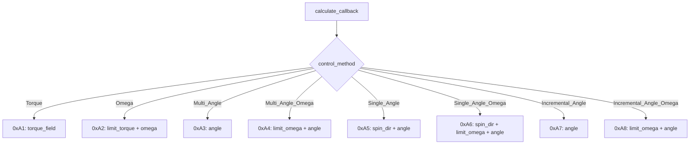

# LK 电机驱动库说明文档

> 基于上海瓴控科技《电机 CAN 总线通讯协议 V2.362》
> 代码参考 DJI/DM 电机驱动框架设计

---

## 1. 系统架构

### 1.1 两种通信模式

| 模式 | CAN ID 规则 | 用途 |
|------|------------|------|
| **命令响应模式** | TX/RX: `0x140 + ID` (ID=1~32) | 电机启停、状态查询、参数配置、精度控制 |
| **连续反馈模式 (1拖4)** | 反馈: `0x200 + ID`, 控制: `0x200`(ID1~4)/`0x1FF`(ID5~8) | 高频实时电流控制 |

当前代码采用**命令响应模式**作为主要控制方式，`1拖4` 连续反馈模式暂未实现。连续反馈模式下，电机主动以 Status 2 (0x9C) 格式上报状态；命令响应模式下，电机收到命令帧后回复对应的响应帧。

### 1.2 文件结构

| 文件 | 说明 |
|------|------|
| `lk_motor.h` | 类型定义、数据结构、类声明、内联函数实现 |
| `lk_motor.cpp` | `lk_motor_normal_class` 成员函数实现 |
| `lk_motor.md` | 本说明文档 |

---

## 2. 数据类型定义

### 2.1 常用枚举

```c
lk_motor_status            // 电机连接状态: Disable / Enable
lk_motor_control_status    // 电机错误标志位 (位掩码, 见 5.1 节)
lk_motor_id_e              // 电机 ID: 0x201 ~ 0x208 (1~8)
lk_motor_control_method    // 控制方式枚举 (见 4.1 节)
lk_motor_sign_edict        // 协议命令码 (见 3.1 节)
```

### 2.2 CAN 源数据 (裸报文)

**Status 2 (0x9C) 响应帧** — 电机反馈的核心数据帧:

```c
typedef struct __attribute__((packed)) {
    uint8_t  command_byte;      // [0] 固定 0x9C
    uint8_t  temperature;       // [1] 电机温度, 1℃/LSB
    int16_t  torque_current;    // [2-3] 转矩电流 (MF: 33/4096 A/LSB, MG/MH: 66/4096 A/LSB)
    int16_t  omega;             // [4-5] 角速度, 1dps/LSB
    uint16_t encoder;           // [6-7] 编码器位置 [0, 65535]
} lk_motor_source_data;
```

**Status 1 (0x9A/0x9B) 响应帧** — 电机状态与错误信息:

```c
typedef struct __attribute__((packed)) {
    uint8_t  command_byte;      // [0] 0x9A (读取) / 0x9B (清除)
    int8_t   temperature;       // [1] 电机温度, 1℃/LSB
    int16_t  voltage_reverse;   // [2-3] 母线电压, 0.01V/LSB
    int16_t  current_reverse;   // [4-5] 母线电流, 0.01A/LSB
    uint8_t  motor_state;       // [6] 0x00=开启, 0x10=关闭
    uint8_t  error_state;       // [7] 错误标志位
} lk_motor_status_error_data_t;
```

### 2.3 经过处理的电机数据

```c
typedef struct {
    float now_angle;            // 输出轴角度, rad
    float now_omega;            // 输出轴角速度, rad/s
    float now_torque;           // 输出轴扭矩, Nm
    float now_temperature;      // 电机温度, ℃
    uint32_t pre_encoder;       // 上一时刻原始编码器值
    int32_t  total_encoder;     // 累计编码器值 (含圈数)
    int32_t  total_round;       // 累计旋转圈数
} lk_motor_processed_data_normal;
```

### 2.4 控制报文结构

| 控制模式 | 命令码 | 结构体 | 有效载荷字段 |
|----------|--------|--------|--------------|
| 转矩闭环 | 0xA1 | `lk_motor_tx_data_torque` | `torque: int16_t` |
| 角速度闭环 | 0xA2 | `lk_motor_tx_data_omega` | `limit_torque: int16_t`, `omega: int32_t` |
| 多圈角度 | 0xA3 | `lk_motor_tx_data_multi_angle` | `angle: int32_t` |
| 多圈角度+角速度 | 0xA4 | `lk_motor_tx_data_multi_angle_omega` | `limit_omega: uint16_t`, `angle: int32_t` |
| 单圈角度 | 0xA5 | `lk_motor_tx_data_single_angle` | `spin_direction: uint8_t`, `angle: uint32_t` |
| 单圈角度+角速度 | 0xA6 | `lk_motor_tx_data_single_angle_omega` | `spin_direction`, `limit_omega: uint16_t`, `angle: uint32_t` |
| 增量角度 | 0xA7 | `lk_motor_tx_data_incremental_angle` | `angle: int32_t` |
| 增量角度+角速度 | 0xA8 | `lk_motor_tx_data_incremental_angle_omega` | `limit_omega: uint8_t`, `angle: int32_t` |

所有控制报文均为 8 字节，小端序。

---

## 3. 命令码列表

### 3.1 电机启停命令

| 命令码 | 宏定义 | 功能 |
|--------|--------|------|
| 0x80 | `Motor_LK_Edict_Motor_Close` | 电机关闭，清除圈数和指令，LED 慢闪 |
| 0x88 | `Motor_LK_Edict_Motor_Open` | 电机运行，LED 常亮，可接收控制指令 |
| 0x81 | `Motor_LK_Edict_Motor_Disable` | 电机停止，不清除运行状态 |
| 0x8C | `Motor_LK_Edict_Brake_Control` | 抱闸器控制/状态读取 |
| 0x07 | `Motor_LK_Edict_Motor_Restart` | 重启电机 (无回复) |

### 3.2 状态查询命令

| 命令码 | 宏定义 | 功能 |
|--------|--------|------|
| 0x9A | `Motor_LK_Edict_Read_Status_Error` | 读取状态1: 温度、电压、电流、错误标志 |
| 0x9B | `Motor_LK_Edict_Clear_Error_Flag` | 清除错误标志 |
| 0x9C | `Motor_LK_Edict_Read_Parameter` | 读取状态2: 温度、转矩电流、转速、编码器 |
| 0x9D | `Motor_LK_Edict_Read_Phase_Current` | 读取状态3: 三相电流 (MS 无效) |

### 3.3 编码器与零点命令

| 命令码 | 宏定义 | 功能 |
|--------|--------|------|
| 0x90 | `Motor_LK_Edict_Read_Encoder_Parameter` | 读取编码器参数 |
| 0x18 | `Motor_LK_Edict_Calibration_Encoder_Parameter` | 校准编码器 (写入 ROM) |
| 0x19 | `Motor_LK_Edict_Set_Motor_Point_ROM` | 设零点 (ROM, 永久保存) |
| 0x95 | `Motor_LK_Edict_Set_Motor_Point_RAM` | 设零点 (RAM, 断电丢失) |
| 0x92 | `Motor_LK_Edict_Read_Multi_Angle_Parameter` | 读取多圈绝对角度 |
| 0x94 | `Motor_LK_Edict_Read_Single_Angle_Parameter` | 读取单圈角度 |

---

## 4. 类 `lk_motor_normal_class` 使用说明

### 4.1 初始化

```cpp
lk_motor_normal_class motor;

void user_init() {
    motor.init(&hfdcan1,                    // FDCAN 句柄
               0x01,                        // CAN ID (1~32, 最终 ID = 0x140 + ID)
               Motor_LK_Control_Method_Normal_Torque,  // 控制方式
               0,                           // 编码器偏移
               0.0f,                        // 就近转位角度 (0=不启用)
               6.0f);                       // 减速比
}
```

**控制方式枚举:**
| 枚举值 | 说明 | 实现状态 |
|--------|------|----------|
| `Motor_LK_Control_Method_Normal_Torque` | 转矩闭环 | ✅ 已实现 |
| `Motor_LK_Control_Method_Normal_Omega` | 角速度闭环 | ✅ 已实现 |
| `Motor_LK_Control_Method_Normal_Multi_Angle` | 多圈角度 | ✅ 已实现 |
| `Motor_LK_Control_Method_Normal_Multi_Angle_Omega` | 多圈角度+角速度 | ✅ 已实现 |
| `Motor_LK_Control_Method_Normal_Single_Angle` | 单圈角度 | ✅ 已实现 |
| `Motor_LK_Control_Method_Normal_Single_Angle_Omega` | 单圈角度+角速度 | ✅ 已实现 |
| `Motor_LK_Control_Method_Normal_Incremental_Angle` | 增量角度 | ✅ 已实现 |
| `Motor_LK_Control_Method_Normal_Incremental_Angle_Omega` | 增量角度+角速度 | ✅ 已实现 |
| `Motor_LK_Control_Method_1_To_4` | 1拖4模式 | ❌ 未实现 |

### 4.2 典型使用流程

```
上电初始化
    │
    ├─→ init()               ← 绑定 CAN、设置控制方式
    │
    ├─→ can_send_enter()     ← 发送 0x88 使能电机
    │
    ├─→ [循环]
    │    ├─ can_rx_callback()  ← CAN 接收中断中调用，解析反馈数据
    │    │    ├─ error_process()  ← 0x9A 帧 → 错误解析
    │    │    └─ data_process()   ← 0x9C/0xA0~0xA8 帧 → 数据处理
    │    │
    │    ├─ set_control_xxx() ← 设置目标值
    │    │
    │    └─ calculate_callback() ← 控制周期中调用，输出控制报文
    │
    ├─→ alive_check()        ← 定期检测电机是否在线
    │
    └─→ can_send_exit()      ← 电机失能
```

### 4.3 公共接口

#### 获取状态数据

| 函数 | 返回 | 说明 |
|------|------|------|
| `get_status()` | `lk_motor_status` | 电机连接状态 (Disable/Enable) |
| `get_now_angle()` | `float` | 输出轴角度, rad |
| `get_now_omega()` | `float` | 输出轴角速度, rad/s |
| `get_now_torque()` | `float` | 输出轴扭矩, Nm |
| `get_now_temperature()` | `float` | 电机温度, ℃ |
| `get_control_method()` | `lk_motor_control_method` | 当前控制方式 |
| `get_control_angle()` | `float` | 当前目标角度, rad |
| `get_control_omega()` | `float` | 当前目标角速度, rad/s |
| `get_control_torque()` | `float` | 当前目标扭矩, Nm |

#### 设置控制参数

| 函数 | 参数 | 说明 |
|------|------|------|
| `set_control_method()` | `lk_motor_control_method` | 切换控制方式 |
| `set_control_angle()` | `float: rad` | 设置目标角度 |
| `set_control_omega()` | `float: rad/s` | 设置目标角速度 |
| `set_control_torque()` | `float: Nm` | 设置目标扭矩 |

#### CAN 基础命令

| 函数 | 命令帧 | 说明 |
|------|--------|------|
| `can_send_enter()` | `{0x88, ...}` | 使能/打开电机 |
| `can_send_exit()` | `{0x80, ...}` | 关闭电机 (清除圈数) |
| `can_send_clear_error()` | `{0x9B, ...}` | 清除错误标志 |
| `can_send_set_zero_ram()` | `{0x95, ...}` | 设置当前零点 (RAM) |
| `can_send_get_status()` | `{0x9A, ...}` | 获取电机状态与错误信息 |

#### 回调函数

| 函数 | 调用周期 | 说明 |
|------|----------|------|
| `can_rx_callback()` | CAN 接收中断 | 命令分发: 0x9A→`error_process()`, 0x9C→`data_process()`, 0xA0~0xA8 控制帧回显→跳过 (数据格式不兼容) |
| `calculate_callback()` | 控制任务周期 | 约束输出值 → 调用 `output()` 发送控制报文 |
| `alive_check()` | 定期 | 滑动窗口检测连接状态, 掉线自动重发使能命令 |

---

## 5. 数据流详解

### 5.1 错误处理流程 (`error_process`)

当收到命令字节为 `0x9A` 的响应帧时，解析 DATA[7] 的错误标志位:

```
DATA[7] 位域:
  Bit 0: 欠压      (0x01) → Motor_LK_Control_Status_UnderVoltage
  Bit 1: 过压      (0x02) → Motor_LK_Control_Status_OverVoltage
  Bit 2: 驱动过温  (0x04) → Motor_LK_Control_Status_Driver_OverTemperature
  Bit 3: 电机过温  (0x08) → Motor_LK_Control_Status_Motor_OverTemperature
  Bit 4: 过流      (0x10) → Motor_LK_Control_Status_OverCurrent
  Bit 5: 短路      (0x20) → Motor_LK_Control_Status_ShortCircuit
  Bit 6: 堵转      (0x40) → Motor_LK_Control_Status_Block
  Bit 7: 通讯丢失  (0x80) → Motor_LK_Control_Status_Signal_Lost
```

> 注意: 电机状态未恢复正常时，错误标志无法通过 0x9B 命令清除。通信丢失后，`alive_check()` 会自动尝试重新使能。

### 5.2 数据处理流程 (`data_process`)

Status 2 (0x9C) 帧的解析步骤:

```
CAN 原始数据 (8字节, 小端序)
    │
    ├─→ 映射为 lk_motor_source_data 结构体
    │
    ├─→ 编码器处理:
    │    ├─ 首次接收 (flag==1 && pre_encoder==0 && total_round==0):
    │    │    └─ pre_encoder = tmp_encoder    (跳过圈数判断)
    │    ├─ delta_encoder = tmp_encoder - pre_encoder
    │    ├─ if  delta_encoder < -(65536/2) → total_round += 1  (正向过圈)
    │    ├─ elif delta_encoder > (65536/2) → total_round -= 1  (反向过圈)
    │    └─ total_encoder = total_round × 65536 + tmp_encoder + encoder_offset
    │
    ├─→ 物理量换算:
    │    ├─ now_angle = total_encoder / 65536 × 2π        [rad]
    │    ├─ now_omega = omega_raw × π/180                  [rad/s]
    │    ├─ now_torque = torque_raw × Current_To_Out × Current_To_Torque  [Nm]
    │    └─ now_temperature = temperature                   [℃]
    │
    └─→ NaN/inf 安全钳位 → pre_encoder = tmp_encoder
```

**关键常量:**

| 常量 | 值 | 说明 |
|------|:--:|------|
| `Encoder_Num_Per_Round` | 65536 | 编码器每圈刻度 (16bit 编码器) |
| `Current_To_Torque` | 0.16 | 电流→扭矩系数, Nm/A |
| `Current_To_Out` | 33/2048 ≈ 0.01611 | 原始电流→安培转换 (MG 系列) |
| `Torque_Out_Max` | 2048 | 最大输出刻度 (指令范围) |

### 5.3 输出流程 (`output`)

`calculate_callback()` 中根据 `control_method` 选择对应的控制报文:



**单位换算:**

| 字段 | 用户设定 (SI) | CAN 报文值 | 换算公式 |
|------|:-------------:|:----------:|----------|
| 转矩 | Nm | 刻度值 | `raw = torque / Current_To_Torque / Current_To_Out` |
| 角速度 | rad/s | 0.01°/LSB | `raw = omega × (180/π) × 100` |
| 角度 | rad | 0.01°/LSB | `raw = angle × (180/π) × 100` |
| 角速度限幅 | rad/s | 1°/LSB | `raw = omega_limit × (180/π)` |

---

## 6. 使用注意事项

### 6.1 上电初始化顺序

1. **先 `init()` → 再 `can_send_enter()`**: 确保 CAN 和内部状态已初始化
2. 发送使能命令后，电机 LED 由慢闪转为常亮
3. 等待首次 `can_rx_callback()` 确认通信建立后再发送控制指令

### 6.2 编码器首次读数

上电时 `pre_encoder` 默认为 0，但绝对编码器实际位置通常不为 0。首次回调时通过以下条件跳过圈数判断:

```cpp
if (rx_data.pre_encoder == 0 && rx_data.total_round == 0 && flag == 1)
    rx_data.pre_encoder = tmp_encoder;
```

> ⚠️ 如果 `can_rx_callback()` 首次收到的是 0x9A 状态帧（而非 0x9C 数据帧），`flag` 会被递增但 `data_process()` 不会被调用。此时后续 0x9C 帧到来时 `flag > 1`，首次跳圈判断失效 — **首次 0x9C 帧可能误判圈数**。需确保上电后尽快发送 0x9C 查询命令，或由电机主动连续反馈。

### 6.3 类型安全性

| 变量 | 类型 | 说明 |
|------|------|------|
| `delta_encoder` | `int32_t` | 必须用 32 位有符号，因阈值 ±32768 触及 int16_t 边界 |
| `tmp_encoder` | `uint16_t` | 与 CAN 报文字段类型一致 |
| `Encoder_Num_Per_Round` | `uint32_t` | 16bit 编码器需 65536，须用 uint32_t 避免溢出 |

### 6.4 `control_status` 的局限

当前 `control_status` 为 `lk_motor_control_status` 枚举，每次 `error_process()` 只保留**最后一个检测到的错误**。若电机同时存在多个错误（如过流 + 堵转），只会记录堵转。如需同时记录多个错误，应将 `control_status` 改为 `uint8_t` 并直接存储 `error_state` 位掩码。

### 6.5 1拖4 模式

`allocate_can_tx_data()` 函数已实现 CAN TX 共享缓冲区分配逻辑 (适配 FDCAN1/2/3, ID 1~8)，但 `lk_motor_normal_class` 未使用。如需 1拖4 连续反馈模式，需参考 `dm_motor_1_to_4_class` 新增一个独立的类实现。

---

## 7. 电机型号参数

| 系列 | 转矩电流分辨率 | 相电流分辨率 | 控制方式 |
|------|:--------------:|:------------:|----------|
| MF | 33/4096 A/LSB | 33/4096 A/LSB | 0xA1 转矩闭环 |
| MG | 66/4096 A/LSB | 66/4096 A/LSB | 0xA1 转矩闭环 |
| MH | 66/4096 A/LSB | 66/4096 A/LSB | 0xA1 转矩闭环 |
| MS | 无 (功率 -1000~1000) | 无 | 0xA0 开环控制 |

注意：当前代码未实现按电机型号切换 `Current_To_Out` 和 `Current_To_Torque`，默认使用 MG 系列参数。使用其他系列电机时需修改这两个常量。

---

## 8. 调试建议

- **Ozone Timeline 污染**: `data_process()` 中的 NaN/inf 钳位可防止异常数据污染统计，但数值跳变仍可能出现。建议排查 CAN 总线电气噪声和终端电阻配置。
- **扭矩读数异常**: 若静止时扭矩值大幅跳变，检查 `tmp_torque_current` 是否声明为 `int16_t`（而非 `uint16_t`），负电流用无符号类型接收会溢出为巨大正值。
- **角度跳变**: 若 `now_angle` 在电机静止时持续增长，检查 `Encoder_Num_Per_Round` 是否与编码器实际分辨率一致，以及 `delta_encoder` 类型是否能容纳 ±32768 的比较范围。
