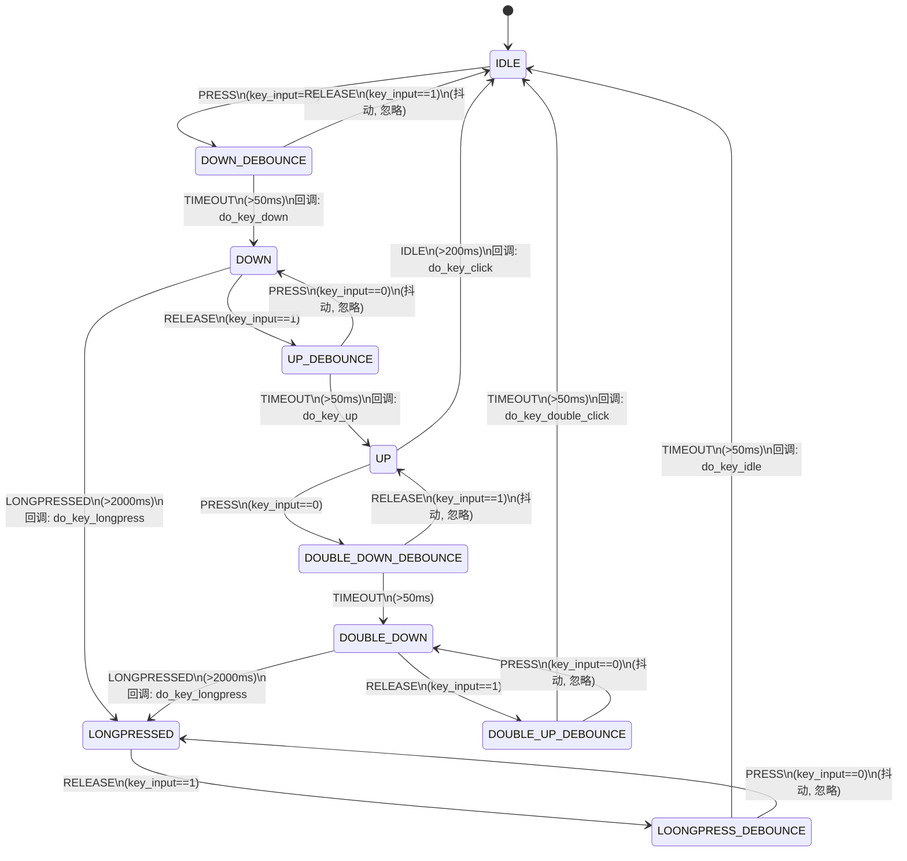
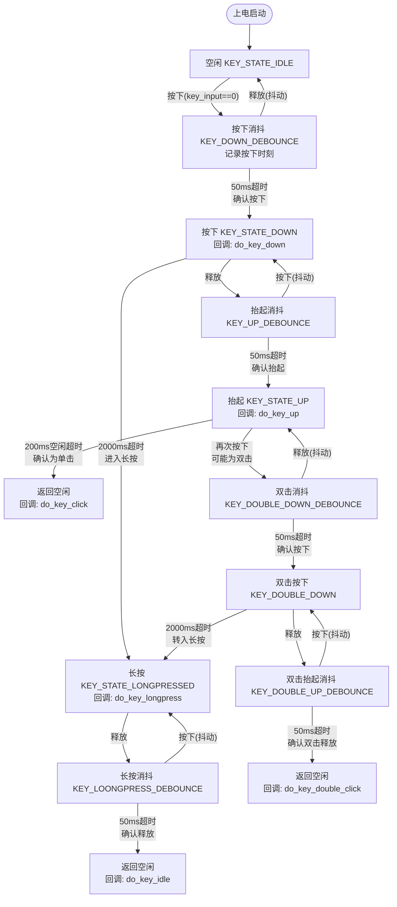
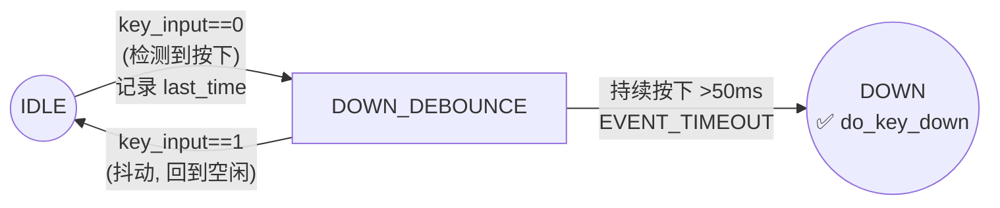
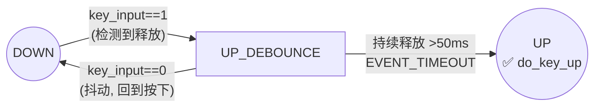
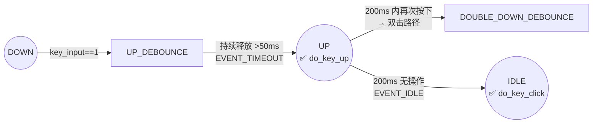
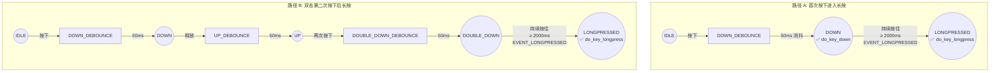
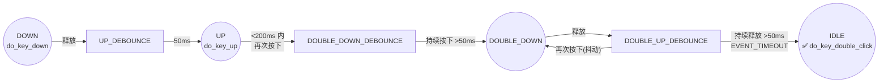
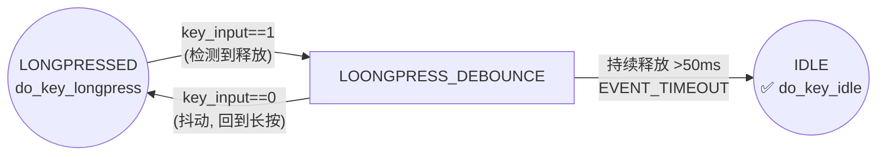

# 按键状态机流程图

## 状态转移总图



---

## 按键行为分支流程图



---

## 状态说明

| 状态 | 枚举值 | 含义 |
|------|--------|------|
| `KEY_STATE_IDLE` | — | 空闲状态，等待按键按下 |
| `KEY_DOWN_DEBOUNCE` | — | 按下消抖，首次检测到按下后等待 50ms 确认 |
| `KEY_STATE_DOWN` | — | 已确认按下，等待释放或长按超时 |
| `KEY_STATE_LONGPRESSED` | — | 长按状态，持续按住 2000ms 后进入 |
| `KEY_LOONGPRESS_DEBOUNCE` | — | 长按释放消抖，等待 50ms 确认释放 |
| `KEY_UP_DEBOUNCE` | — | 抬起消抖，检测到释放后等待 50ms 确认 |
| `KEY_STATE_UP` | — | 已确认抬起，等待空闲超时或再次按下 |
| `KEY_DOUBLE_DOWN_DEBOUNCE` | — | 双击第二次按下消抖，等待 50ms 确认 |
| `KEY_DOUBLE_DOWN` | — | 双击第二次已确认按下，等待释放 |
| `KEY_DOUBLE_UP_DEBOUNCE` | — | 双击抬起消抖，等待 50ms 确认释放 |

---

## 事件说明

| 事件 | 触发条件 |
|------|----------|
| `KEY_EVENT_PRESS` | `key_input() == 0`（低电平有效，按下） |
| `KEY_EVENT_RELEASE` | `key_input() == 1`（高电平，释放） |
| `KEY_EVENT_TIMEOUT` | 当前状态持续时间超过对应阈值（50 ms） |
| `KEY_EVENT_LONGPRESSED` | DOWN / DOUBLE_DOWN 状态持续超过 `KEY_LONGPRESS_MS`（2000 ms） |
| `KEY_EVENT_IDLE` | UP 状态持续超过 `KEY_IDLE_TIMEOUT_MS`（200 ms） |

---

## 时间参数

| 宏定义 | 数值 | 用途 |
|--------|------|------|
| `KEY_DEBOUNCE_MS` | 50 ms | 消抖时间，用于按下/释放确认 |
| `KEY_IDLE_TIMEOUT_MS` | 200 ms | UP 状态空闲超时，超时后确认为单击 |
| `KEY_LONGPRESS_MS` | 2000 ms | 长按判定时间，按住超过此值触发长按 |

---

## 回调函数

| 回调 | 触发时机 | 状态转移 |
|------|----------|----------|
| `do_key_down` | 按下消抖确认后 | `DOWN_DEBOUNCE → DOWN` |
| `do_key_up` | 抬起消抖确认后 | `UP_DEBOUNCE → UP` |
| `do_key_click` | UP 状态 200ms 无操作 | `UP → IDLE`（单击确认） |
| `do_key_longpress` | 长按 2000ms | `DOWN → LONGPRESSED` / `DOUBLE_DOWN → LONGPRESSED` |
| `do_key_double_click` | 双击抬起消抖确认后 | `DOUBLE_UP_DEBOUNCE → IDLE`（双击确认） |
| `do_key_idle` | 长按释放消抖确认后 | `LOONGPRESS_DEBOUNCE → IDLE` |

---

## 各回调函数触发流程分析

### 1. do_key_down — 按键按下确认

**触发条件**：首次检测到按下 → 消抖 50ms 期间持续保持按下 → 确认为有效按下。



| 条件 | 要求 |
|------|------|
| 初始状态 | `KEY_STATE_IDLE` |
| 触发事件 | `KEY_EVENT_PRESS`（电平 = 0）→ `KEY_DOWN_DEBOUNCE` → `KEY_EVENT_TIMEOUT`（≥ 50ms） |
| 消抖要求 | 消抖期间电平必须持续为 0，否则回到 IDLE |
| 时序 | 按下下降沿起 50ms 后触发 |

```
电平:  ───────┐     ┌────────
             │     │
             └─────┘
             | 50ms|
             ↑      ↑
         记录时刻   do_key_down ✅
```

---

### 2. do_key_up — 按键释放确认

**触发条件**：有效按下后检测到释放 → 消抖 50ms 期间持续保持释放 → 确认为有效抬起。



| 条件 | 要求 |
|------|------|
| 初始状态 | `KEY_STATE_DOWN` |
| 触发事件 | `KEY_EVENT_RELEASE`（电平 = 1）→ `KEY_UP_DEBOUNCE` → `KEY_EVENT_TIMEOUT`（≥ 50ms） |
| 消抖要求 | 消抖期间电平必须持续为 1，否则回到 DOWN |
| 时序 | 释放上升沿起 50ms 后触发 |

```
电平:  ───────┐        ┌───────
             │        │
             └────────┘
                      | 50ms|
                      ↑      ↑
                  释放时刻   do_key_up ✅
```

---

### 3. do_key_click — 单击确认

**触发条件**：有效按下 → 有效释放 → 200ms 内无再次按下 → 确认为单击。



| 条件 | 要求 |
|------|------|
| 初始状态 | `KEY_STATE_UP` |
| 前置条件 | 已完成一次完整的按下→释放流程（do_key_down → do_key_up 已触发） |
| 触发事件 | `KEY_EVENT_IDLE`（在 UP 状态停留 ≥ 200ms 无再次按下） |
| 互斥条件 | 若 200ms 内再次按下，进入双击路径，不会触发 click |

```
电平:  ───┐      ┌──────────────────
         │      │
         └──────┘
          |  50ms|      |  200ms  |
                       ↑          ↑
                   do_key_up   do_key_click ✅
```

---

### 4. do_key_longpress — 长按确认

**触发条件（路径 A）**：有效按下后持续按住 ≥ 2000ms。
**触发条件（路径 B）**：双击第二次按下后持续按住 ≥ 2000ms。



| 条件 | 要求 |
|------|------|
| 初始状态 | `KEY_STATE_DOWN` 或 `KEY_DOUBLE_DOWN` |
| 触发事件 | `KEY_EVENT_LONGPRESSED`（在当前状态停留 ≥ 2000ms） |
| 时序 | 进入 DOWN / DOUBLE_DOWN 后开始计时，2000ms 后触发 |

```
电平:  ───┐                              ┌─────
         │                              │
         └──────────────────────────────┘
          |  50ms|     | 1950ms |       |
                  ↑              ↑
             do_key_down   do_key_longpress ✅
```

---

### 5. do_key_double_click — 双击确认

**触发条件**：有效按下 → 有效释放 → 200ms 内再次按下 → 再次释放 → 消抖完成。



| 条件 | 要求 |
|------|------|
| 初始状态 | `KEY_DOUBLE_UP_DEBOUNCE` |
| 前置条件 | 第一次按下→释放完成（已进入 UP），<200ms 内检测到第二次按下 |
| 触发事件 | `KEY_EVENT_TIMEOUT`（第二次释放消抖 ≥ 50ms） |
| 关键约束 | 两次按下间隔 < 200ms；双击第二次若持续 ≥ 2000ms 则转为长按 |

```
电平:  ───┐    ┌──┐    ┌──────────
         │    │  │    │
         └────┘  └────┘
          |50ms|  |<200| |50ms|
                              ↑
                      do_key_double_click ✅
```

---

### 6. do_key_idle — 长按释放后空闲

**触发条件**：长按状态下释放按键 → 消抖 50ms 确认释放 → 回到空闲。



| 条件 | 要求 |
|------|------|
| 初始状态 | `KEY_LOONGPRESS_DEBOUNCE` |
| 前置条件 | 必须先进入 LONGPRESSED 状态（即触发了 do_key_longpress）并释放按键 |
| 触发事件 | `KEY_EVENT_TIMEOUT`（释放消抖 ≥ 50ms） |
| 互斥条件 | 消抖期间若再次按下，回到 LONGPRESSED，不触发 idle |

```
电平:  ───┐                        ┌─────
         │                        │
         └────────────────────────┘
                                 |50ms|
                                 ↑     ↑
                              释放    do_key_idle ✅
```

---

### 回调触发条件速查表

| 回调 | 物理操作 | 触发时刻 | 不可同时触发 |
|------|----------|----------|-------------|
| **do_key_down** | 按下并保持 50ms | 消抖确认后立即 | — |
| **do_key_up** | 释放并保持 50ms | 消抖确认后立即 | — |
| **do_key_click** | 短按后松手 | 松手后 200ms | 双击（互斥，由 200ms 窗口区分） |
| **do_key_longpress** | 按住不松 | 按下后 2000ms | 单击/双击（一旦长按，松手后触发 do_key_idle 而非 click/dblclick） |
| **do_key_double_click** | 短按→松手→再短按→松手 | 第二次松手消抖后 | 单击（先到先得） |
| **do_key_idle** | 长按后松手 | 松手消抖后 | 仅限长按路径 |

---

## 典型按键时序

### 单击
```
电平:  ─────┐     ┌──────────
           │     │
           └─────┘
状态: IDLE → D_DB → DOWN → U_DB → UP → IDLE(click)
时间:       0ms    50ms   释放   50ms   +200ms
                                ↑ do_key_down
                                      ↑ do_key_up
                                              ↑ do_key_click
```

### 长按
```
电平:  ─────┐                        ┌─────
           │                        │
           └────────────────────────┘
状态: IDLE → D_DB → DOWN → ... → LONGPRESSED → LP_DB → IDLE(idle)
时间:       0ms   50ms   +2000ms   +2000ms      释放   +50ms
                         ↑ do_key_longpress              ↑ do_key_idle
```

### 双击
```
电平:  ───┐    ┌──┐    ┌──────────
         │    │  │    │
         └────┘  └────┘
状态: IDLE → D_DB → DOWN → U_DB → UP → DDB → DD → DUB → IDLE(dblclick)
时间:       0ms   50ms   释放   50ms   按下  50ms  释放  50ms
                                                         ↑ do_key_double_click
```
